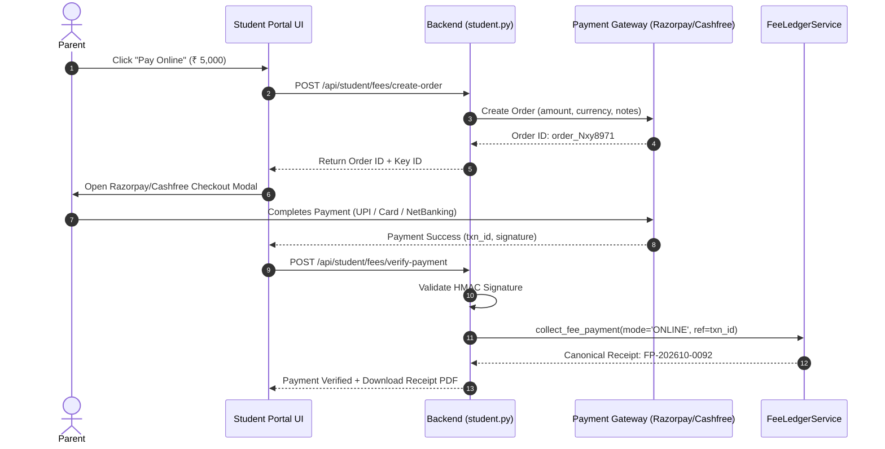
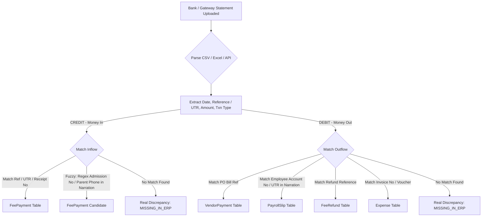
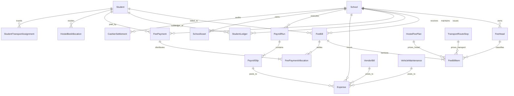

# EduERP Unified Finance, Fees & Cross-Module Accounting Architecture
**Document Version:** 6.0.0 (Master Dynamic & Complete Service Integration Architecture)  
**Date:** October 18, 2026  
**Audited & Designed Modules:** `Accountant Dashboard`, `Finance Command Center`, `Student & Parent Portal`, `Teacher Dashboard & My HR`, `Hostel & Warden Operations`, `Transport Fleet Logistics`, `Library Desk Circulation`, `Admissions (Walk-in & Prov.)`, `Examinations & Admit Card Gating`, `HRMS & Payroll Engine`, `Procurement & Asset Register`, `Bank & Gateway Reconciliation`, `SuperAdmin SaaS Subscriptions`, `Finance Aggregation Service`, `PnL Service`, `Migration Service`, `Fee Central Service`, `Fee Service Intelligence`, `Archive Service`, `Fee Refund & Cancellation Engine`, `Staff Attendance & Regularization`, `Staff Advances & Full & Final Settlement`  
**Purpose:** Authoritative target blueprint for enterprise multi-tenant school financial operations. Resolves all legacy table fragmentation, mathematical compounding defects, and departmental data silos while supporting granular, real-world school billing rules (Class/Stream-wise fees, Hostel Floor/Room/AC pricing, Transport Stop/Route slabs, Dual Admission lifecycles, Online Payment Gateway integration, Cash Register day-end closing, HRMS statutory payroll, and audit-grade P&L).

---

## Table of Contents
1. [Architectural Principles & Core Philosophy](#1-architectural-principles--core-philosophy)
2. [Multi-Tenant Dynamic Isolation & Security Standards](#2-multi-tenant-dynamic-isolation--security-standards)
3. [Master Chart of Accounts & Dynamic Fee Heads Hierarchy](#3-master-chart-of-accounts--dynamic-fee-heads-hierarchy)
4. [Modular Dynamic Pricing & Ingestion Engines](#4-modular-dynamic-pricing--ingestion-engines)
   - 4.1 [School Academic Fee Engine (Class, Stream & Session)](#41-school-academic-fee-engine-class-stream--session)
   - 4.2 [Hostel Granular Dynamic Pricing Engine (Building, Floor, Room Type & AC)](#42-hostel-granular-dynamic-pricing-engine-building-floor-room-type--ac)
   - 4.3 [Transport Slab & Route Pricing Engine (Routes, Stops & Directionality)](#43-transport-slab--route-pricing-engine-routes-stops--directionality)
   - 4.4 [Dual Admission Financial Lifecycles (Instant Walk-in vs Provisional Pipeline)](#44-dual-admission-financial-lifecycles-instant-walk-in-vs-provisional-pipeline)
   - 4.5 [Examination & Gating Engine (Registration, Hall Tickets & Clearance Threshold)](#45-examination--gating-engine-registration-hall-tickets--clearance-threshold)
   - 4.6 [Library & Disciplinary Penalties Engine (Students vs Staff Payroll Recovery)](#46-library--disciplinary-penalties-engine-students-vs-staff-payroll-recovery)
   - 4.7 [Concessions, Scholarships & Sibling Discounts Engine (Correct Mathematical Model)](#47-concessions-scholarships--sibling-discounts-engine-correct-mathematical-model)
5. [Student Accounts Receivable (AR) & Unified Billing Pipeline](#5-student-accounts-receivable-ar--unified-billing-pipeline)
   - 5.1 [Decoupled Demand vs Arrears Mathematical Model](#51-decoupled-demand-vs-arrears-mathematical-model)
   - 5.2 [Advance Fees as Unearned Revenue Liability](#52-advance-fees-as-unearned-revenue-liability)
   - 5.3 [Single Canonical Payment Collection Gateway Function](#53-single-canonical-payment-collection-gateway-function)
   - 5.4 [Cumulative Double-Entry Running Balance Engine](#54-cumulative-double-entry-running-balance-engine)
6. [Student & Parent Portal: Online Payment Gateway & Real-Time Statements](#6-student--parent-portal-online-payment-gateway--real-time-statements)
7. [Daily Cash Drawer, Counter Cashier Register & Day-End Settlement](#7-daily-cash-drawer-counter-cashier-register--day-end-settlement)
8. [HRMS Payroll, Statutory Deductions & Attendance Synchronization](#8-hrms-payroll-statutory-deductions--attendance-synchronization)
   - 8.1 [Accrual Gross Payroll & Statutory Liabilities](#81-accrual-gross-payroll--statutory-liabilities)
   - 8.2 [Staff Advances & Emergency Loans Subledger](#82-staff-advances--emergency-loans-subledger)
   - 8.3 [Mid-Month Joiner Prorated Compensation & Statutory Deductions](#83-mid-month-joiner-prorated-compensation--statutory-deductions)
   - 8.4 [Unpaid Leave (LWP) vs Paid Leave Payroll Synchronization Standard](#84-unpaid-leave-lwp-vs-paid-leave-payroll-synchronization-standard)
9. [Procurement, Inventory & Fixed Assets Register (CAPEX vs OPEX & Depreciation)](#9-procurement-inventory--fixed-assets-register-capex-vs-opex--depreciation)
   - 9.1 [Procurement Segregation: OPEX vs CAPEX](#91-procurement-segregation-opex-vs-capex)
   - 9.2 [Monthly Asset Depreciation Engine](#92-monthly-asset-depreciation-engine)
   - 9.3 [Asset Scrap & Disposal Revenue Posting to Central Finance](#93-asset-scrap--disposal-revenue-posting-to-central-finance)
10. [True Operating Profit & Loss (P&L) Engine (Cash vs Accrual Basis)](#10-true-operating-profit--loss-pl-engine-cash-vs-accrual-basis)
   - 10.1 [Accrual Accounts Payable vs Cash Expense Segregation](#101-accrual-accounts-payable-vs-cash-expense-segregation)
   - 10.2 [Unpaid Staff Salary Liability Tracking in Accrual P&L](#102-unpaid-staff-salary-liability-tracking-in-accrual-pl)
11. [Bank & Payment Gateway Reconciliation Engine (Fuzzy Matching & Split Settlement)](#11-bank--payment-gateway-reconciliation-engine-fuzzy-matching--split-settlement)
12. [Concurrency Locks & Database Numeric Precision Standards](#12-concurrency-locks--database-numeric-precision-standards)
13. [Target Database Schema Blueprint & Entity-Relationship Mapping](#13-target-database-schema-blueprint--entity-relationship-mapping)
14. [Database Table Clean-up, Deprecation & Migration Roadmap](#14-database-table-clean-up-deprecation--migration-roadmap)
15. [Academic Session Rollover, Student Promotion & Opening Balance Pipeline](#15-academic-session-rollover-student-promotion--opening-balance-pipeline)
16. [Strict Read-Only Separation & Analytics Architecture](#16-strict-read-only-separation--analytics-architecture)
17. [Immutable Historical Class Snapshots (`class_id` Denormalization)](#17-immutable-historical-class-snapshots-class_id-denormalization)
18. [Automated Dynamic Late Fine Slab Engine & Grace Periods](#18-automated-dynamic-late-fine-slab-engine--grace-periods)
19. [Online Payment Gateway Backend & Webhook Verification Architecture](#19-online-payment-gateway-backend--webhook-verification-architecture)
20. [Cheque Dishonor & Bounced Instrument Protocol](#20-cheque-dishonor--bounced-instrument-protocol)
21. [Caution Money Escrow Liability & Graduation Clearance Ledger](#21-caution-money-escrow-liability--graduation-clearance-ledger)
22. [Cross-Module No-Dues Clearance & Transfer Certificate (TC) Gating Pipeline](#22-cross-module-no-dues-clearance--transfer-certificate-tc-gating-pipeline)
23. [Family Group Entity & Automated Sibling Discount Engine](#23-family-group-entity--automated-sibling-discount-engine)
24. [GST Statutory Tax Accounting & Input Tax Credit (ITC) Subledger](#24-gst-statutory-tax-accounting--input-tax-credit-itc-subledger)
25. [Canonical Unified Payroll Disbursement Architecture & Legacy Deprecation](#25-canonical-unified-payroll-disbursement-architecture--legacy-deprecation)
26. [Gross Salary Accounting & Statutory Liabilities Subledger (EPF, ESIC, TDS, PT)](#26-gross-salary-accounting--statutory-liabilities-subledger-epf-esic-tds-pt)
27. [Employer Statutory Contributions & True Cost-to-Company (CTC) Engine](#27-employer-statutory-contributions--true-cost-to-company-ctc-engine)
28. [Staff Loans & Salary Advances Ledger (Asset Accounting & Auto-Recovery)](#28-staff-loans--salary-advances-ledger-asset-accounting--auto-recovery)
29. [Staff Ward Fee Concession Dynamic Linkage & Staff Welfare Accounting](#29-staff-ward-fee-concession-dynamic-linkage--staff-welfare-accounting)
30. [Full & Final (F&F) Settlement & Multi-Departmental Staff Clearance Workflow](#30-full--final-ff-settlement--multi-departmental-staff-clearance-workflow)
31. [Payroll Arrears & Retroactive Attendance Regularization Engine](#31-payroll-arrears--retroactive-attendance-regularization-engine)
32. [Corporate Net Banking Bulk Disbursement File Generator & Staff Reimbursements](#32-corporate-net-banking-bulk-disbursement-file-generator--staff-reimbursements)

---

---

---

## 1. Architectural Principles & Core Philosophy

```
UNIFIED ENTERPRISE FINANCE ARCHITECTURE:
┌────────────────────────────────────────────────────────────────────────────────────────┐
│                              CENTRAL FINANCE CORE (SSOT)                               │
│                                                                                        │
│   ┌────────────────────────┐   ┌────────────────────────┐   ┌──────────────────────┐   │
│   │   ACADEMIC TUITION     │   │     HOSTEL & MESS      │   │ TRANSPORT OPERATIONS │   │
│   │ Class / Stream Rates   │   │ Building / Floor / AC  │   │ Route / Stop Slabs   │   │
│   └───────────┬────────────┘   └───────────┬────────────┘   └──────────┬───────────┘   │
│               │                            │                           │               │
│               └────────────────────┬───────┴───────────────────────────┘               │
│                                    ▼                                                   │
│                      ┌──────────────────────────┐                                      │
│                      │   UNIFIED FEE BILLING    │                                      │
│                      │ (fee_bills / bill_items) │                                      │
│                      └─────────────┬────────────┘                                      │
│                                    ▼                                                   │
│                      ┌──────────────────────────┐                                      │
│                      │  STUDENT GENERAL LEDGER  │                                      │
│                      │  (student_ledgers / AR)  │                                      │
│                      └─────────────┬────────────┘                                      │
│                                    ▼                                                   │
│                      ┌──────────────────────────┐                                      │
│                      │ SINGLE RECEIPT AUTHORITY │                                      │
│                      │ (fee_payments / allocs)  │                                      │
│                      └─────────────┬────────────┘                                      │
│                                    │                                                   │
│         INFLOW CASH                │                  OUTFLOW EXPENSES                 │
│         ───────────────────────────┴──────────────────────────────────                 │
│         ▲                                                            ▲                 │
│         │                                                            │                 │
│   ┌─────┴──────────────┐                                      ┌──────┴──────────────┐  │
│   │ BANK STATEMENT     │                                      │   ACCOUNTS PAYABLE  │  │
│   │ RECONCILIATION     │                                      │ HRMS Gross Payroll  │  │
│   │ (bank_transactions)│                                      │ Fleet Bus Repairs   │  │
│   └────────────────────┘                                      │ Vendor PO Bills     │  │
│                                                               └─────────────────────┘  │
└────────────────────────────────────────────────────────────────────────────────────────┘
```

1. **Single Source of Truth (SSOT):** No department (Hostel, Transport, Library, Admissions) may maintain independent shadow billing records (`transport_fee_records`, `hostel_fine_records`, `fee_records`). All financial obligations must exist as itemized lines on a central bill (`FeeBillItem`), and all money collections must pass through central receipts (`FeePayment`).
2. **Strict Separation of Period Demand vs Cumulative Debt:**
   - **Current Month Demand:** The exact monetary value of services consumed in the current billing cycle. It never changes regardless of whether prior bills were paid.
   - **Arrears (Past Dues):** Historical unpaid balance from prior cycles. It is presented on fee slips for settlement, but **never added into `FeeBill.total_payable` or debited into `StudentLedger` a second time**, preventing compounding mathematical bugs.
3. **Double-Entry Sub-Ledger Discipline:**
   - Every invoice creates a Debit in Accounts Receivable (`StudentLedger`) and a Credit in Operating Revenue (General Ledger).
   - Every collection creates a Debit in Cash/Bank and a Credit in Accounts Receivable.
   - Overpayments credit an **Advance Fee Liability Account** (Unearned Revenue), never modifying past invoices.
4. **Strict CAPEX vs OPEX Segregation:** Fixed capital assets (Buses, Laptops, Laboratory Equipment) purchased via procurement must be capitalized into `SchoolAsset` and depreciated, rather than dumped into single-month operational consumable expenses.
5. **Universal Portal Synchronization:** The Student Dashboard, Parent Portal, Accountant Dashboard, and Principal Dashboard must all query the same authoritative tables (`FeeBill`, `FeePayment`, `StudentLedger`), guaranteeing zero data divergence across roles.

---

## 2. Multi-Tenant Dynamic Isolation & Security Standards

EduERP is a multi-tenant platform. No logic, rate, or fee head may be static or hardcoded in Python code. Every school operates as an autonomous financial tenant.

```
MULTI-TENANT DYNAMIC ISOLATION MODEL:
┌──────────────────────────────────────────────────────────────────────────────────┐
│ SCHOOL TENANT A (CBSE High School, Delhi)                                        │
│ • Session: 2026-27 (Starts April)                                                │
│ • Dynamic FeeHeads: TUITION, SCIENCE_LAB, TRANSPORT, SMART_CLASS                 │
│ • Cadence: Quarterly (April, July, Oct, Jan)                                     │
│ • Custom Bank Accounts: HDFC Main Fee A/c, SBI Escrow                            │
├──────────────────────────────────────────────────────────────────────────────────┤
│ SCHOOL TENANT B (Residential International Academy, Dehradun)                    │
│ • Session: 2026-27 (Starts July)                                                 │
│ • Dynamic FeeHeads: TUITION, HOSTEL_AC_DOUBLE, MESS, HORSE_RIDING, CAMBRIDGE_EXAM│
│ • Cadence: Bi-Annual / Term-wise                                                 │
│ • Custom Bank Accounts: ICICI Operational A/c, Razorpay Merchant Gateway         │
├──────────────────────────────────────────────────────────────────────────────────┤
│ ZERO DATA BLEED ENFORCEMENT:                                                     │
│ • Every financial query is scoped by `school_id = sid`                           │
│ • Compound database indexes on `(school_id, ...)` prevent cross-tenant scans     │
│ • Role-Based IDOR verification prevents students from viewing peer ledgers       │
└──────────────────────────────────────────────────────────────────────────────────┘
```

### 2.1 Security & IDOR Access Control Guard
To close the privacy vulnerability identified in `fees_finance.py:1155`, every financial endpoint accessing student records must execute mandatory tenant and identity verification:

```python
def verify_financial_access(user, student_id):
    """
    Enforces multi-tenant isolation and prevents Insecure Direct Object References (IDOR).
    Students may only view their own ledger; Parents only their registered children;
    Staff requires administrative accounting privileges.
    """
    if not user or not user.school_id:
        return None, ('Unauthorized', 401)
    
    student = Student.query.get(student_id)
    if not student or student.school_id != user.school_id:
        return None, ('Student not found in this institution', 404)
        
    role_str = str(getattr(user.role, 'value', user.role)).upper()
    if role_str == 'STUDENT':
        if student.user_id != user.id:
            return None, ('Forbidden: You cannot inspect another student\'s financial ledger', 403)
    elif role_str == 'PARENT':
        if student.parent_phone != user.phone and student.parent_email != user.email:
            # Check family guardian link table if implemented
            return None, ('Forbidden: Unauthorized child ledger access', 403)
    elif role_str not in ('PRINCIPAL', 'ACCOUNTANT', 'SUPER_ADMIN', 'ADMIN', 'VICE_PRINCIPAL'):
        return None, ('Forbidden: Insufficient privileges to view student financial sub-ledger', 403)
        
    return student, None
```

---

## 3. Master Chart of Accounts & Dynamic Fee Heads Hierarchy

```
FEE HEADS CHART OF ACCOUNTS:
├── ACADEMIC (Department: ACCOUNTS)
│   ├── TUITION            (Monthly / Quarterly - Academic tuition rate)
│   ├── ADMISSION_FEE      (One-time - Non-refundable entrance charge)
│   ├── REGISTRATION_FEE   (One-time - Application processing charge)
│   ├── CAUTION_MONEY      (One-time - REFUNDABLE LIABILITY)
│   ├── LAB_COMPUTER       (Per Term - Practical computer lab usage)
│   ├── LAB_SCIENCE        (Per Term - Physics/Chemistry/Biology consumables)
│   ├── EXAM_FEE           (Per Semester - Mid-term & Annual board examination)
│   └── DEVELOPMENT_FEE    (Annual - Campus infrastructure maintenance)
├── TRANSPORT (Department: TRANSPORT)
│   ├── TRANSPORT_FEE      (Monthly - Route & distance slab fare)
│   └── TRANSPORT_FINE     (Ad-hoc - Route violation / vehicle damage)
├── HOSTEL (Department: HOSTEL)
│   ├── HOSTEL_LODGING     (Monthly/Term - Room rent by floor & sharing tier)
│   ├── HOSTEL_MESS        (Monthly - Food and dining services)
│   ├── HOSTEL_AMENITY     (Monthly - Air conditioning & laundry surcharge)
│   ├── HOSTEL_SECURITY    (One-time - REFUNDABLE LIABILITY deposit)
│   └── HOSTEL_FINE        (Ad-hoc - Room damage / disciplinary fine)
└── LIBRARY & DISCIPLINARY (Department: LIBRARY)
    ├── LIBRARY_FINE       (Ad-hoc - Overdue book late return charge)
    ├── BOOK_REPLACEMENT   (Ad-hoc - Lost or damaged book recovery)
    └── ID_CARD_REISSUE    (Ad-hoc - Lost smart card replacement fee)
```

### 3.1 Accounting Classification Rules:
- **Operating Revenue (Income):** `TUITION`, `TRANSPORT_FEE`, `HOSTEL_LODGING`, `HOSTEL_MESS`, `LAB_SCIENCE`, `EXAM_FEE`. Credited to operating revenue upon demand generation.
- **Current Liabilities (Refundable Deposits & Advances):** `CAUTION_MONEY`, `HOSTEL_SECURITY`, `ADVANCE_FEES`. Held on the balance sheet as obligations; never recognized as operating profit.
- **Contra-Revenue (Discounts & Waivers):** `SCHOLARSHIP`, `SIBLING_DISCOUNT`, `STAFF_CONCESSION`. Offsets gross billed demand to reflect true net receivable.

---

## 4. Modular Dynamic Pricing & Ingestion Engines

### 4.1 School Academic Fee Engine (Class, Stream & Session)
Academic fees vary dynamically by class, session, and stream. The structure is governed by `fee_structures_v2` and `fee_structure_items_v2`.
- When generating monthly bills for Class 11-A (Science Stream), the engine queries `FeeStructureV2.filter_by(school_id=sid, class_id=11, stream='SCIENCE', session='2026-27')`.
- Student custom exemptions (`student_fee_assignments`) suppress optional fee items (e.g. computer lab waiver for vocational students).

---

### 4.2 Hostel Granular Dynamic Pricing Engine (Building, Floor, Room Type & AC)
Hostel pricing is governed by an explicit multi-dimensional matrix: `hostel_fee_plans`.

| Field Name | Type | Description | Example |
|---|---|---|---|
| `hostel_id` | Integer (FK) | Hostel Master Reference | `1 (Boys Hostel)` |
| `building_id` | Integer (FK) | Specific building (or NULL for all) | `Building A` |
| `floor_id` | Integer (FK) | Specific floor (or NULL for all) | `Floor 1` |
| `room_type` | String | Room Sharing Tier | `DOUBLE_SHARING` |
| `is_ac` | Boolean | Climate Control Flag | `True (AC Room)` |
| `lodging_fee` | Numeric(12,2)| Base Room Rental Charge | `₹ 4,500.00 / month` |
| `mess_fee` | Numeric(12,2)| Catering & Dining Charge | `₹ 3,500.00 / month` |
| `amenity_fee` | Numeric(12,2)| Electricity / Laundry / WiFi | `₹ 1,000.00 / month` |
| `security_deposit`| Numeric(12,2)| Refundable Caution Deposit | `₹ 10,000.00 (One-Time)` |

#### Automated Central Ingestion:
Instead of creating isolated `FeeRecord` entries in `hostel_fee_service.py`, bed charges are ingested as itemized lines on the central bill:
```python
def get_student_hostel_charges(school_id, student_id, bill_month):
    alloc = HostelBedAllocation.query.filter_by(school_id=school_id, student_id=student_id, status='ACTIVE').first()
    if not alloc:
        return []
    room = alloc.bed.room
    plan = HostelFeePlan.query.filter(
        HostelFeePlan.school_id == school_id,
        HostelFeePlan.hostel_id == room.floor.building.hostel_id,
        or_(HostelFeePlan.floor_id == room.floor_id, HostelFeePlan.floor_id == None),
        HostelFeePlan.room_type == room.room_type,
        HostelFeePlan.is_ac == room.is_ac,
        HostelFeePlan.status == 'ACTIVE'
    ).order_by(HostelFeePlan.floor_id.desc().nullslast()).first()

    return [
        {'head_code': 'HOSTEL_LODGING', 'department': 'HOSTEL', 'amount': plan.lodging_fee, 'name': f'Room {room.room_number} ({room.room_type})'},
        {'head_code': 'HOSTEL_MESS', 'department': 'HOSTEL', 'amount': plan.mess_fee, 'name': 'Hostel Dining & Catering'},
        {'head_code': 'HOSTEL_AMENITY', 'department': 'HOSTEL', 'amount': plan.amenity_fee, 'name': 'Electricity & Laundry Services'}
    ]
```

---

### 4.3 Transport Slab & Route Pricing Engine (Routes, Stops & Directionality)
Transport charges depend on pickup stops and directionality:
1. **Stop Slabs:** Pickup stops (`transport_stops`) define monthly rates (e.g. Stop A = ₹1,200/mo, Stop B = ₹1,800/mo).
2. **Directionality:** One-way pickup or one-way drop charges 60% of two-way fare.
3. **Ingestion into Central Billing:** The transport manager does not maintain disconnected billing tables (`transport_fee_records`). Central billing pulls the rate and adds `FeeBillItem(fee_head='TRANSPORT_FEE')`.

---

### 4.4 Dual Admission Financial Lifecycles (Instant Walk-in vs Provisional Pipeline)

```
ADMISSION WORKFLOW COMPARISON:
┌────────────────────────────────────────────────────────┐  ┌────────────────────────────────────────────────────────┐
│ WORKFLOW 1: INSTANT WALK-IN ADMISSION                  │  │ WORKFLOW 2: PROVISIONAL / LEAD PIPELINE                │
│ (Direct Counter Admission)                             │  │ (Online Inquiry, Entrance Test, Document Review)      │
├────────────────────────────────────────────────────────┤  ├────────────────────────────────────────────────────────┤
│ 1. Parent at Admission Desk                            │  │ 1. Online Inquiry Submitted                            │
│ 2. Student created as ACTIVE immediately               │  │ 2. Student created as PROVISIONAL (PROV-2026-0042)     │
│ 3. Permanent Admission No: ADM-2026-XXXX               │  │ 3. Token Registration Fee Collected                    │
│ 4. Rate card selected                                  │  │ 4. Seat earmarked; Entrance evaluated                  │
│ 5. Initial Admission Bill generated                    │  │ 5. Principal confirms admission:                      │
│ 6. Payment collected (Cash/UPI/Card)                   │  │    • Student promoted to ACTIVE                        │
│ 7. Single canonical receipt: FP-202610-XXXX            │  │    • Converted to ADM-2026-XXXX                        │
│ 8. Enrolled in Class, Transport & Hostel               │  │    • Single canonical receipt: FP-202610-XXXX          │
└────────────────────────────────────────────────────────┘  └────────────────────────────────────────────────────────┘
```

#### Permanent Multi-Receipt Bug Resolution:
- Legacy `_gen_receipt()` and direct writes to `FeeTransaction` are permanently excised.
- Both workflows invoke `FeeLedgerService.collect_fee_payment()`.
- A single canonical receipt number (`FP-YYYYMM-XXXX`) is stored on `FeePayment`, printed on parent slips, and posted to `StudentLedger`.

---

### 4.5 Examination & Gating Engine (Registration, Hall Tickets & Clearance Threshold)

```
EXAM GATING & CLEARANCE PIPELINE:
┌────────────────────────┐      ┌────────────────────────┐      ┌────────────────────────┐
│  Exam Schedule Created │─────▶│ Exam Fee Ingested      │─────▶│  Fee Collection Cycle  │
│(Mid-Term / Annual Exam)│      │(FeeHead: 'EXAM_FEE')   │      │(Tuition + Exam Settled)│
└────────────────────────┘      └────────────────────────┘      └───────────┬────────────┘
                                                                            │
                                                                            ▼
                                                                ┌────────────────────────┐
                                                                │  Admit Card PDF Gate   │
                                                                │(principal.py / portal) │
                                                                └───────────┬────────────┘
                                                                            │
                                  ┌─────────────────────────────────────────┴─────────────────────────────────────────┐
                                  ▼                                                                                   ▼
                     [Outstanding <= Threshold]                                                           [Outstanding > Threshold]
                                  │                                                                                   │
                                  ▼                                                                                   ▼
                     ┌────────────────────────┐                                                          ┌────────────────────────┐
                     │  Admit Card Generated  │                                                          │  HTTP 402 Required     │
                     │  Watermark: 'CLEARED'  │                                                          │  "Please clear pending │
                     └────────────────────────┘                                                          │   dues of ₹ X to issue"│
                                                                                                         └────────────────────────┘
```

#### Clearance Gate Implementation:
In `principal.py:4049` (`admit_card_pdf`), generation is conditioned on financial balance:
```python
def check_exam_clearance(school_id, student_id):
    """Verifies student financial standing against school clearance policy."""
    ledger_balance = get_student_current_balance(student_id)
    # Threshold configurable per school (e.g. ₹500 tolerance for late bus fare)
    policy_threshold = get_school_clearance_threshold(school_id) or 0.0
    if ledger_balance > policy_threshold:
        return False, f"Fee clearance required: Outstanding balance of ₹{ledger_balance:,.2f} exceeds permitted threshold of ₹{policy_threshold:,.2f}"
    return True, None
```

---

### 4.6 Library & Disciplinary Penalties Engine (Students vs Staff Payroll Recovery)
1. **Students:** Late returns and damaged books generate a `StudentLedger` Debit under `FeeHead('LIBRARY_FINE')`. They can be paid immediately at the library counter via `FeePayment` or rolled into the next monthly demand bill.
2. **Staff / Teachers:** Teachers cannot have student ledger entries. When a teacher incurs a library fine, it is posted to `EmployeeSalaryDeduction(component='LIBRARY_PENALTY')`. During monthly HRMS payroll, this amount is automatically deducted from their payslip.

---

### 4.7 Concessions, Scholarships & Sibling Discounts Engine (Correct Mathematical Model)
To eliminate the severe compounding bug identified in `fee_ledger_service.py:1584` where a fixed discount is deducted from every item of every bill in a loop:

```python
def apply_concession_and_adjust_bills(
    school_id, student_id, fee_head_id=None,
    concession_type='WAIVER', discount_type='FIXED',
    discount_value=0.0, reason='', session=None,
    actor_user=None
):
    """
    Applies a concession correctly by allocating the fixed discount
    once against target bill items until the discount value is exhausted.
    """
    discount_value = round(float(discount_value), 2)
    remaining_discount = discount_value

    open_bills = FeeBill.query.filter(
        FeeBill.student_id == student_id,
        FeeBill.school_id == school_id,
        FeeBill.status.in_([BillStatus.ISSUED.value, BillStatus.PARTIALLY_PAID.value, BillStatus.OVERDUE.value])
    ).order_by(FeeBill.bill_month.asc(), FeeBill.id.asc()).all()

    actual_deducted = 0.0

    for bill in open_bills:
        if remaining_discount <= 0:
            break
        for itm in bill.items:
            if remaining_discount <= 0:
                break
            if fee_head_id is None or itm.fee_head_id == fee_head_id:
                base_due = round(itm.net_amount - (itm.paid_amount or 0.0), 2)
                if base_due <= 0:
                    continue
                if discount_type == 'PERCENTAGE':
                    disc_amt = min(round(itm.original_amount * (discount_value / 100.0), 2), base_due)
                else:
                    disc_amt = min(remaining_discount, base_due)

                itm.discount_amount = round((itm.discount_amount or 0.0) + disc_amt, 2)
                itm.net_amount = round(max(0.0, itm.original_amount - itm.discount_amount), 2)
                itm.balance_amount = round(max(0.0, itm.net_amount - (itm.paid_amount or 0.0)), 2)
                
                if discount_type == 'FIXED':
                    remaining_discount = round(remaining_discount - disc_amt, 2)
                actual_deducted = round(actual_deducted + disc_amt, 2)

        bill.calculate_totals()

    # Credit Student Ledger strictly by actual deducted amount
    ledger_entry = StudentLedger(
        school_id=school_id,
        student_id=student_id,
        entry_type='CREDIT',
        entry_date=date.today(),
        amount=actual_deducted,
        reference_no=f"CONC-{conc.id}",
        description=f"Concession Granted ({concession_type}): ₹{actual_deducted:.2f}. Reason: {reason}",
        created_by=actor_user.id if actor_user else None,
    )
    db.session.add(ledger_entry)
```

---

## 5. Student Accounts Receivable (AR) & Unified Billing Pipeline

### 5.1 Decoupled Demand vs Arrears Mathematical Model
To eliminate exponential mathematical compounding ($2K \to 4K \to 8K \to 16K$), `FeeBill` enforces complete mathematical decoupling:

$$\text{total\_current\_charges} = \sum_{i=1}^{n} \text{FeeBillItem.original\_amount}_i$$

$$\text{total\_payable} \equiv \text{total\_current\_charges} - \text{total\_discount} + \text{total\_late\_fine} \quad \text{(Strict Current Equality)}$$

$$\text{previous\_dues} = \text{Historical Unpaid Balance (Informational Notice Only)}$$

$$\text{Parent Total Outstandings (Display Only)} = \text{total\_payable} + \text{previous\_dues}$$

#### Student Ledger Debit Rule:
When generating a bill, `StudentLedger` is debited **ONLY by `total_payable` (current new charges)**. Previous dues are NEVER posted into the general ledger a second time because they already exist as debits from prior months!

---

### 5.2 Advance Fees as Unearned Revenue Liability
When a parent pays more than the outstanding debt:
1. All pending invoices are marked `PAID`.
2. The surplus cash is credited to the student's sub-ledger with transaction type **`ADVANCE_CREDIT`**.
3. In General Ledger accounting, this is classified under **Current Liabilities (Unearned Revenue)**.
4. **Automated Offset on Next Cycle:** When the next billing cycle generates an invoice, the system automatically runs an advance offset:
   - Debit: `AdvanceFeeLiability`
   - Credit: `AccountsReceivable (Student Bill)`
   - The fee notice displays: "Current Demand: ₹3,000 | Advance Adjusted: -₹2,000 | **Net Amount Payable: ₹1,000**".

---

### 5.3 Single Canonical Payment Collection Gateway Function
To permanently eliminate the 7 competing payment collection functions (`FeeLedgerService.collect_fee_payment`, `FeeCentralService.collect_payment`, `transport_fee_service.record_transport_fee_payment`, `hostel_fee_service.record_hostel_fee_payment`, `library_fee_service.record_library_fine_payment`, `principal.py:collect_fee`, `principal.py:collect_multiple`), all cash desk, online gateway, and mobile collections are strictly routed through a single transactional entry point:

```python
def collect_canonical_payment(
    school_id: int,
    student_id: int,
    amount_paid: Decimal,
    payment_mode: str = 'CASH', # CASH, UPI, ONLINE, CHEQUE, BANK_TRANSFER, DD
    transaction_ref: str = None,
    collected_by_id: int = None,
    department: str = 'ACCOUNTS', # ACCOUNTS, TRANSPORT, HOSTEL, LIBRARY, ADMISSION
    remarks: str = '',
    target_bill_id: int = None,
    target_fee_head_id: int = None,
    custom_receipt_no: str = None,
    payment_date: date = None
) -> dict:
    """
    Authoritative Single Point of Payment Entry across the entire ERP.
    Guarantees:
    1. Transactional isolation with pessimistic locking (with_for_update).
    2. Atomic single receipt generation (FP-YYYYMM-XXXX).
    3. Strict FIFO allocation across oldest unpaid bills and bill items.
    4. Surplus funds credited to StudentLedger as ADVANCE_CREDIT.
    5. Automatic cumulative running balance (balance_after) maintenance.
    6. Absolutely NO legacy shadow table (FeeTransaction, TransportFeeTransaction) insertion.
    """
    # 1. Acquire pessimistic lock on Student record
    student = Student.query.filter_by(id=student_id, school_id=school_id).with_for_update().first_or_404()
    p_date = payment_date or date.today()
    session = student.session or get_current_academic_session(school_id)

    # 2. Canonical Receipt Number Generation (Gapless Monotonic Sequence)
    if custom_receipt_no:
        receipt_no = custom_receipt_no
    else:
        seq_obj = db.session.query(func.coalesce(func.max(FeePayment.id), 0)).scalar() + 1
        receipt_no = f"FP-{p_date.year}{p_date.month:02d}-{seq_obj:05d}"

    # 3. Create Master FeePayment Record (Single Source of Truth)
    payment = FeePayment(
        receipt_no=receipt_no,
        school_id=school_id,
        student_id=student_id,
        session=session,
        payment_date=p_date,
        total_paid=amount_paid,
        payment_mode=payment_mode.upper(),
        transaction_ref=transaction_ref or '',
        collected_by=collected_by_id,
        department=department.upper(),
        remarks=remarks,
        status='VALID'
    )
    db.session.add(payment)
    db.session.flush()

    # 4. Atomic Allocation Engine (FIFO across Open Bills & Items)
    remaining_cash = amount_paid
    allocated_items = []

    open_bills_q = FeeBill.query.filter(
        FeeBill.student_id == student_id,
        FeeBill.school_id == school_id,
        FeeBill.status.in_(['ISSUED', 'PARTIALLY_PAID', 'OVERDUE'])
    ).order_by(FeeBill.due_date.asc(), FeeBill.id.asc()).with_for_update()

    if target_bill_id:
        open_bills = [FeeBill.query.get(target_bill_id)]
    else:
        open_bills = open_bills_q.all()

    for bill in open_bills:
        if remaining_cash <= Decimal('0.00'):
            break
        for item in bill.items:
            if remaining_cash <= Decimal('0.00'):
                break
            if target_fee_head_id and item.fee_head_id != target_fee_head_id:
                continue

            item_bal = item.net_amount - (item.paid_amount or Decimal('0.00'))
            if item_bal <= Decimal('0.00'):
                continue

            settle_slice = min(remaining_cash, item_bal)
            item.paid_amount = (item.paid_amount or Decimal('0.00')) + settle_slice
            item.balance_amount = max(Decimal('0.00'), item.net_amount - item.paid_amount)
            remaining_cash -= settle_slice

            # Create granular Payment Allocation
            allocation = FeePaymentAllocation(
                payment_id=payment.id,
                bill_id=bill.id,
                bill_item_id=item.id,
                fee_head_id=item.fee_head_id,
                department=item.department,
                allocated_amount=settle_slice
            )
            db.session.add(allocation)
            allocated_items.append((item, settle_slice))

        bill.calculate_totals()

    # 5. Handle Advance Overpayment (Surplus Cash)
    advance_amount = Decimal('0.00')
    if remaining_cash > Decimal('0.00'):
        advance_amount = remaining_cash
        adv_allocation = FeePaymentAllocation(
            payment_id=payment.id,
            allocated_amount=advance_amount,
            department='ACCOUNTS',
            remarks='Unearned Revenue / Advance Fee Credit'
        )
        db.session.add(adv_allocation)

    # 6. Post Double-Entry StudentLedger CREDIT with Authoritative Cumulative Running Balance
    post_student_ledger_credit(
        school_id=school_id,
        student_id=student_id,
        amount=amount_paid,
        payment_id=payment.id,
        receipt_no=receipt_no,
        description=f"Fee Collection: {payment_mode} (Receipt #{receipt_no})",
        actor_id=collected_by_id,
        session=session
    )

    db.session.commit()
    return {
        'payment_id': payment.id,
        'receipt_no': receipt_no,
        'total_paid': float(amount_paid),
        'advance_credited': float(advance_amount),
        'status': 'SUCCESS'
    }
```

---

### 5.4 Cumulative Double-Entry Running Balance Engine
To fix `fee_central_service.py:223` where `balance_after` was corrupted with an individual item's balance, `StudentLedger` calculates running balance as the cumulative sum of all historical debits and credits:

$$\text{Running Balance After Entry } k = \sum_{i=1}^{k} (\text{Debit Amount}_i) - \sum_{i=1}^{k} (\text{Credit Amount}_i)$$

```python
def get_current_student_balance(school_id: int, student_id: int) -> Decimal:
    """Calculates authoritative real-time net receivable balance from StudentLedger."""
    res = db.session.query(
        func.coalesce(func.sum(case((StudentLedger.entry_type == 'DEBIT', StudentLedger.amount), else_=Decimal('0.00'))), Decimal('0.00')).label('total_debit'),
        func.coalesce(func.sum(case((StudentLedger.entry_type == 'CREDIT', StudentLedger.amount), else_=Decimal('0.00'))), Decimal('0.00')).label('total_credit')
    ).filter(
        StudentLedger.school_id == school_id,
        StudentLedger.student_id == student_id
    ).first()
    return (res.total_debit - res.total_credit) if res else Decimal('0.00')

def post_student_ledger_credit(school_id, student_id, amount, payment_id, receipt_no, description, actor_id, session):
    """Posts a credit entry into StudentLedger with correct cumulative running balance."""
    current_bal = get_current_student_balance(school_id, student_id)
    new_running_bal = current_bal - Decimal(str(amount))

    ledger_entry = StudentLedger(
        school_id=school_id,
        student_id=student_id,
        entry_type='CREDIT',
        entry_date=date.today(),
        amount=amount,
        balance_after=new_running_bal, # <--- Strictly Authoritative Cumulative Balance
        payment_id=payment_id,
        reference_no=receipt_no,
        description=description,
        session=session,
        created_by=actor_id
    )
    db.session.add(ledger_entry)
```

---

## 6. Student & Parent Portal: Online Payment Gateway & Real-Time Statements

### 6.1 Unified Portal Migration Architecture
The Student and Parent Portal (`StudentDashboard.jsx`, `student.py:255`) is migrated off legacy `FeeRecord` to the canonical engine:

```
PORTAL UNIFIED DATA PIPELINE:
Student / Parent Browser
          │
          ▼
GET /api/student/fees?session=2026-27
          │
          ▼
┌────────────────────────────────────────────────────────┐
│ Canonical FeeLedgerService.get_student_summary()       │
│ • Fetches active FeeBills (Current Demand)             │
│ • Fetches FeePayment Receipts (Verified Cash/Online)   │
│ • Fetches StudentLedger Balance (Real Net Receivable)  │
│ • Fetches Itemized Breakdown per FeeHead               │
└────────────────────────────────────────────────────────┘
```

### 6.2 Online Payment Gateway (Razorpay / Cashfree / UPI Dynamic QR)
Schools require automated parent self-service fee settlement:



---

## 7. Daily Cash Drawer, Counter Cashier Register & Day-End Settlement

A major source of untraceable cash leakage in schools is un-reconciled counter collections. EduERP introduces the **Counter Cash Register System**:

```
DAILY CASHIER CLOSING & HANDOVER WORKFLOW:
  Morning Opening             Daytime Counter Collections             Evening Day-End Settlement
         │                                  │                                      │
         ▼                                  ▼                                      ▼
┌──────────────────┐               ┌──────────────────┐                  ┌──────────────────┐
│ Cash Drawer Open │               │ Fee Payments     │                  │ Cash Settlement  │
│ Cashier: Ramesh  │──────────────▶│ Collected (CASH) │─────────────────▶│ Denominations:   │
│ Opening: ₹ 2,000 │               │ Total: ₹ 84,500  │                  │ 500x 160 = 80,000│
│                  │               │                  │                  │ 200x  25 =  5,000│
└──────────────────┘               └──────────────────┘                  │ 100x  15 =  1,500│
                                                                         │ Total:   ₹ 86,500│
                                                                         └─────────┬────────┘
                                                                                   │
                                                                                   ▼
                                                                         ┌──────────────────┐
                                                                         │ Cash-to-Bank     │
                                                                         │ Deposit Slip     │
                                                                         │ Contra Entry     │
                                                                         └──────────────────┘
```

### 7.1 Cash Settlement Model: `cashier_settlements`
- `cashier_user_id`: The staff member operating the counter.
- `opening_float`: Initial cash change in drawer (e.g. ₹2,000).
- `system_cash_collected`: Sum of `FeePayment` where `payment_mode='CASH'` and `collected_by=cashier_id` for that date.
- `physical_cash_counted`: Physical cash counted by cashier with denomination breakdown.
- `variance`: `physical_cash_counted - (opening_float + system_cash_collected)`.
- `supervisor_signoff`: Principal / Head Accountant verification before bank deposit.

---

## 8. HRMS Payroll, Statutory Deductions & Staff Loans Subledger

### 8.1 Accrual Gross Payroll & Statutory Liabilities
To resolve `payroll_engine.py:468` where only net salary was expensed, EduERP enforces enterprise payroll accounting:

```
PAYROLL GENERAL LEDGER ACCRUAL MATRIX:
Date: 28th of Month (Payroll Approval)
  Debit:  OPERATING EXPENSE: Academic Staff Salary (Gross Basic + HRA)   ₹ 12,00,000
  Debit:  OPERATING EXPENSE: Non-Teaching Staff Salary (Gross)           ₹  4,00,000
  Debit:  OPERATING EXPENSE: Employer PF Contribution (12% Matching)     ₹  1,20,000
  Debit:  OPERATING EXPENSE: Employer ESI Contribution (3.25% Matching)  ₹    32,500
  Credit: CURRENT LIABILITY: Employee PF Payable                         ₹  2,40,000
  Credit: CURRENT LIABILITY: Employee ESI Payable                        ₹    45,000
  Credit: CURRENT LIABILITY: TDS (Income Tax) Payable                    ₹    85,000
  Credit: CURRENT LIABILITY: Net Salary Payable                          ₹ 13,82,500
  Credit: LOAN ASSET: Employee Emergency Loan Repayment                  ₹   50,000
```

### 8.2 Staff Advances & Emergency Loans Subledger
A dedicated model tracks staff loans:
- `employee_loans`: Loan principal, interest rate, disbursement date, total EMI tenure.
- `employee_loan_installments`: Linked to payslip item deductions; automatically reduces outstanding principal each month.

---

### 8.3 Mid-Month Joiner Prorated Compensation & Statutory Deductions
To eliminate the ₹0 net salary bug where pre-employment calendar days were penalized as unexcused absences at a working-day penalty rate (`payroll_engine.py:196`), mid-month joiners and exits follow positive earned-days proration:

$$\text{Earned Gross Salary} = \text{Base Monthly Gross} \times \left( \frac{\text{Payable Days Actually Worked}}{\text{Applicable Calendar or Working Days in Month}} \right)$$

```python
def calculate_mid_month_compensation(user, year, month, base_gross, profile, policy='PAYABLE_DAYS'):
    """
    Computes prorated compensation for staff joining or exiting mid-month.
    Pre-employment days are strictly excluded from absent penalties.
    """
    total_days = calendar.monthrange(year, month)[1]
    m_start = date(year, month, 1)
    m_end = date(year, month, total_days)

    joining = profile.joining_date if profile and profile.joining_date else m_start
    exit_dt = profile.exit_date if profile and profile.exit_date else m_end

    effective_start = max(m_start, joining)
    effective_end = min(m_end, exit_dt)

    # Count actual payable days between effective_start and effective_end
    earned_payable_days = count_payable_days_in_window(user.id, effective_start, effective_end, year, month)
    
    # Prorated Gross
    prorated_gross = round(base_gross * (Decimal(str(earned_payable_days)) / Decimal(str(total_days))), 2)

    # Prorated Statutory Caps (e.g. PF statutory basic capped proportionally)
    prorated_basic = round(prorated_gross * Decimal('0.50'), 2)
    pf_employee = round(min(prorated_basic, Decimal('15000.00')) * Decimal('0.12'), 2)
    pf_employer = pf_employee

    return {
        'earned_payable_days': earned_payable_days,
        'prorated_gross': float(prorated_gross),
        'pf_employee': float(pf_employee),
        'pf_employer': float(pf_employer)
    }
```

---

### 8.4 Unpaid Leave (LWP) vs Paid Leave Payroll Synchronization Standard
To fix `payroll_engine.py:230` where all `ON_LEAVE` attendance records were treated as 100% paid leave:
1. `StaffAttendance` is upgraded with `leave_request_id` foreign key.
2. If `attendance.leave_request_id` references a `LeaveRequest` where `leave_type.is_paid == False` (LWP), the payroll engine strictly tallies `unpaid_leave_days += 1.0`.
3. If an attendance record has `status == 'ON_LEAVE'` without an approved `LeaveRequest` in `hrms_service`, it is classified as `UNEXCUSED_LEAVE` and deducted as 1 full LOP day.

---

## 9. Procurement, Inventory & Fixed Assets Register (CAPEX vs OPEX & Depreciation)

### 9.1 Procurement Segregation: OPEX vs CAPEX
In `procurement_service.py`, vendor bills are classified based on the purchase order's `target_type`:

```
PROCUREMENT CLASSIFICATION:
                   3-Way Matched Vendor Bill Approved
                                  │
                 ┌────────────────┴────────────────┐
                 ▼                                 ▼
      [target_type == 'INVENTORY']       [target_type == 'ASSET']
         Stationery, Lab Reagents           Buses, Computers, Benches
                 │                                 │
                 ▼                                 ▼
     ┌───────────────────────┐         ┌───────────────────────┐
     │  OPEX Expense Booked  │         │  CAPEX Capitalization │
     │ • category='STATIONERY│         │ • Added to            │
     │ • Fully expensed in   │         │   school_assets       │
     │   month of purchase   │         │ • Monthly Straight-   │
     │                       │         │   Line Depreciation   │
     └───────────────────────┘         └───────────────────────┘
```

### 9.2 Monthly Asset Depreciation Engine
Fixed assets (Buses, Laptops, Benches) are depreciated monthly over their useful life:
$$\text{Monthly Depreciation} = \frac{\text{Purchase Value} - \text{Salvage Value}}{\text{Useful Life in Months}}$$
- Debit: `Expense(category='DEPRECIATION')`
- Credit: `AccumulatedDepreciationAssetAccount`

---

### 9.3 Asset Scrap & Disposal Revenue Posting to Central Finance
To prevent unrecorded cash leakages upon asset retirement (`asset_service.py:195`):
1. **Asset Disposal Cash Inflow Posting:** When an asset is retired with `disposal_amount > 0`, the system automatically records a realized revenue transaction in Central Finance:
   - Debit: `Cash / Bank Account`
   - Credit: `Asset Cost (school_assets.purchase_cost)`
   - Credit / Debit: `Gain / Loss on Asset Disposal`
2. **Loss on Asset Disposal Expense:** If `disposal_amount < net_book_value`, the difference is automatically booked as:
   `Expense(category='LOSS_ON_ASSET_DISPOSAL', amount=(net_book_value - disposal_amount))`
3. **Disposal Receipt Generation:** Generates official scrap sale invoice `SCRAP-YYYY-XXXX` signed by Principal and Accountant.

---

## 10. True Operating Profit & Loss (P&L) Engine (Cash vs Accrual Basis)

```
COMPREHENSIVE AUDIT-GRADE P&L STATEMENT:
─────────────────────────────────────────────────────────────────────────────
1. OPERATING REVENUE (EARNED DEMAND)
   • Academic Tuition Fees (Gross Billed)                ₹ 18,50,000.00
   • Transport Operations Revenue                        ₹  3,80,000.00
   • Hostel Lodging & Amenities                          ₹  2,90,000.00
   • Hostel Catering & Dining                            ₹  2,20,000.00
   • Examination & Registration Fees                     ₹  1,40,000.00
   • Library Fines & Service Penalties                   ₹    18,000.00
   -------------------------------------------------------------------------
   GROSS OPERATING REVENUE:                              ₹ 28,98,000.00
   Less: Student Concessions & Sibling Waivers          (₹  1,85,000.00)
   -------------------------------------------------------------------------
   NET RECOGNIZED REVENUE:                               ₹ 27,13,000.00

2. OPERATING EXPENSES (INCURRED PERFORMANCE)
   • Academic Staff Salaries (HRMS Gross)                ₹ 11,20,000.00
   • Non-Teaching Staff Salaries (Gross)                 ₹  3,50,000.00
   • Institutional Employer PF & ESI Contributions       ₹  1,52,500.00
   • Fleet Fuel & Vehicle Maintenance (transport_maint)  ₹  1,85,000.00
   • Hostel Catering Provisions & Groceries              ₹  1,60,000.00
   • Campus Electricity, Water & High-Speed Internet     ₹    95,000.00
   • Consumable Stationery & Educational Supplies        ₹    65,000.00
   • Fixed Asset Depreciation Charge                     ₹    55,000.00
   • Software Gateway & Cloud Infrastructure Charges     ₹    40,000.00
   -------------------------------------------------------------------------
   TOTAL OPERATING EXPENSES:                             ₹ 22,22,500.00

3. NET OPERATING SURPLUS / (DEFICIT):                    +₹  4,90,500.00
   OPERATING SURPLUS MARGIN:                                      18.08 %
─────────────────────────────────────────────────────────────────────────────
```

### 10.1 Accrual Accounts Payable vs Cash Expense Segregation
To prevent multi-period expense double counting (`pnl_service.py:214` + `procurement_service.py:353`):
1. **Accrual Expense Recognition Point:** In Accrual basis, an operational purchase expense is recognized on the **GRN / Vendor Bill approval date**, regardless of whether cash has been paid.
2. **Cash Settlement Point:** When `record_vendor_bill_payment` executes in subsequent periods:
   - Debit: `AccountsPayableLiability` (reduces vendor liability)
   - Credit: `Bank / Cash Account`
   - It is strictly **excluded** from subsequent period's Accrual expenses.
3. **Formula for Period Expenses:**
   $$\text{Accrual Operating Expenses} = \text{Direct Non-Vendor Operating Expenses} + \sum \text{VendorBill.total\_amount in Period} + \text{Depreciation} + \text{Gross Payroll}$$
   $$\text{Cash Operating Outflows} = \sum \text{Cash Payments Made in Period (Expenses + VendorPayments + Net Salaries)}$$

---

### 10.2 Unpaid Staff Salary Liability Tracking in Accrual P&L
To fix the complete omission of unpaid salaries from P&L liabilities:
1. When monthly payroll runs are generated (`status in ['DRAFT', 'PENDING_APPROVAL', 'APPROVED']`), the unpaid gross salaries and institutional statutory employer contributions are tallied into `total_unpaid_liabilities`.
2. A school with ₹15,00,000 in monthly staff salaries waiting for disbursement correctly shows this ₹15,00,000 as an operating liability under Accrual reporting, preventing fictitious profit reporting.

---

## 11. Bank & Payment Gateway Reconciliation Engine (Fuzzy Matching & Split Settlement)



#### Smart Gateway Commission Split (`AMOUNT_MISMATCH`):
When a parent pays ₹10,000 online, but the bank statement credits ₹9,812.00 (deducting 1.88% Razorpay commission):
- The matching engine detects: `diff = 188.00`.
- Clicking *"Accept with Gateway Commission"* automatically:
  1. Marks statement transaction `CONFIRMED`.
  2. Creates `Expense(category='SOFTWARE_SUBSCRIPTION', title='Payment Gateway MDR Fee', amount=188.00)`.
  3. Leaves the student's bill at ₹10,000 settled with zero residual balance.

---

## 12. Concurrency Locks & Database Numeric Precision Standards

1. **Fixed-Point Database Numeric Standard:**
   - All monetary columns in `fee_finance.py`, `finance.py`, `transport.py`, and `hostel.py` are standardized to:
     ```python
     db.Column(db.Numeric(12, 2), nullable=False, default=Decimal('0.00'))
     ```
   - This eliminates IEEE-754 floating-point drift (`0.30000000000000004`) and ensures strict mathematical equality.
2. **Pessimistic Database Row Locking (`with_for_update`):**
   - In-memory `threading.Lock` is replaced with atomic database locks:
     ```python
     student = Student.query.filter_by(id=student_id).with_for_update().first()
     bill = FeeBill.query.filter_by(id=bill_id).with_for_update().first()
     ```
   - Concurrent payments from multiple counters or duplicate double-clicks queue safely in the database without balance corruption.

---

## 13. Target Database Schema Blueprint & Entity-Relationship Mapping



---

## 14. Database Table Clean-up, Deprecation & Migration Roadmap

### 14.1 Deprecation Matrix
The following 10 legacy or rogue shadow tables are permanently sunset or merged:

| Old / Rogue Table | Replacement Canonical Table | Migration Action |
|---|---|---|
| `fee_structures` | `fee_structures_v2` & `items` | Export active rows to V2; drop table. |
| `fee_records` | `fee_bills` & `fee_bill_items` | Migrate unpaid balances to `StudentLedger` opening balances; sunset writes. |
| `fee_transactions` | `fee_payments` & `allocations` | Read-only archive; stop inserting new rows. |
| `fee_receipt_groups` | `fee_payments` | Drop table; multi-head receipts natively handled in V2. |
| `salary_records` | `payroll_runs` & `payroll_slips` | Drop table; migrate history to HRMS slips. |
| `staff_salary_records` | `payroll_runs` & `payroll_slips` | Drop table; migrate history to HRMS slips. |
| `transport_fee_records`| `fee_bill_items` | Drop table; generate route charges via central billing. |
| `transport_fee_transactions` | `fee_payments` | Drop table; all transport collections route through central cashier. |
| `hostel_inventory` | `school_assets` | Migrate room furniture into central asset register. |
| `service_charges` | `subscription_invoices` | Drop table; unify under platform `subscription.py`. |
| `exam_schedules` (in `financial.py`) | `curriculum.py` | Move class declaration to academic curriculum module. |
| `timetables` (in `financial.py`) | `curriculum.py` | Move class declaration to academic curriculum module. |

---

### 14.2 Phased Implementation Roadmap

```
REMEDIATION ROADMAP:
┌──────────────────────────┐      ┌──────────────────────────┐      ┌──────────────────────────┐
│         PHASE 1          │      │         PHASE 2          │      │         PHASE 3          │
│   Calculation Math &     │─────▶│   Portal, Gating &       │─────▶│   Shadow Elimination &   │
│   Dashboard Date Filters │      │   Modular Ingestion      │      │   Schema Migration       │
└──────────────────────────┘      └──────────────────────────┘      └──────────────────────────┘
```

1. **Phase 1: Calculation Math & Dashboard Date Filters (Immediate / Zero DB Migration):**
   - Decouple `previous_dues` from `FeeBill.total_payable` formula.
   - Post only current new charges into `StudentLedger` on bill creation.
   - Enforce date boundaries (`date_from`, `date_to`) derived from month in `FinanceAggregationService`.
   - Fix date string parsing in `PnLService`.
   - Fix concession loop in `apply_concession_and_adjust_bills`.
   - Add `_verify_student_access` IDOR guard on student ledger endpoints.
2. **Phase 2: Portal, Gating & Modular Ingestion:**
   - Migrate Student & Parent Portal fee views to query `FeeBill`, `FeeBillItem`, and `StudentLedger`.
   - Implement Exam Admit Card fee clearance gate threshold.
   - Harmonize Admission receipt generation to single canonical `FP-YYYYMM-XXXX`.
   - Ingest Hostel bed allocations into `FeeBillItem` and route Warden dashboard correctly.
   - Ingest Transport route stops into `FeeBillItem` and hook `VehicleMaintenance` to `Expense`.
   - Route staff library fines to HRMS salary deductions.
   - Implement counter Cash Register day-end settlement.
3. **Phase 3: Shadow Elimination & Schema Migration:**
   - Execute zero-data-loss migration script moving legacy arrears to `StudentLedger`.
   - Drop dead tables: `fee_structures`, `fee_transactions`, `fee_receipt_groups`, `salary_records`, `staff_salary_records`, `service_charges`, `transport_fee_records`, `hostel_inventory`.
   - Relocate academic models from `financial.py` to `curriculum.py`.
   - Validate live Cash vs Accrual P&L dashboard and Bank Reconciliation matching.

---

## 15. Academic Session Rollover, Student Promotion & Opening Balance Pipeline

When transitioning from Session `2025-26` to `2026-27`, student financial balances must roll over cleanly without generating synthetic invoices or corrupting history:

```
ACADEMIC SESSION ROLLOVER LIFECYCLE:
  Session 2025-26 Close               Session 2026-27 Initialization
          │                                         │
          ▼                                         ▼
┌───────────────────┐                     ┌───────────────────┐
│ Freeze 2025-26    │                     │ Create Enrollment │
│ FeeBills & Ledgers│────────────────────▶│ for Target Class  │
│ Final Audit Check │                     │ (e.g. Class 7->8) │
└───────────────────┘                     └─────────┬─────────┘
                                                    │
                                                    ▼
                                          ┌───────────────────┐
                                          │ Ingest Net Arrears│
                                          │ as Opening Balance│
                                          │ DEBIT in Ledger   │
                                          └─────────┬─────────┘
                                                    │
                                                    ▼
                                          ┌───────────────────┐
                                          │ Generate Initial  │
                                          │ FeeBillItem under │
                                          │ FeeHead('ARREARS')│
                                          └───────────────────┘
```

1. **Net Arrears Calculation on Session Close:**
   $$\text{Session Rollover Balance} = \text{get\_current\_student\_balance(school\_id, student\_id)}$$
2. **Opening Balance Head Generation:**
   - Instead of creating an unbillable standalone ledger row (`migration_service.py:591`), the rollover engine generates a canonical `FeeBillItem` under `FeeHead(category='OPENING_BALANCE', name='Previous Session Arrears')`.
   - This ensures the migrated balance is 100% visible on parent portals and instantly payable via Razorpay/Cashfree online checkouts.
3. **Provisional Student Promotion Hook:**
   - In `admission_service.py:promote_provisional_student`, promoting a student from `PROVISIONAL` to `ACTIVE` automatically triggers generation of the student's initial session demand bill (`FeeBill` for Tuition, Admission, Term Charges) so no admitted student remains stranded with ₹0 billing demand.

---

## 16. Strict Read-Only Separation & Analytics Architecture

A fundamental architectural rule of high-reliability ERP systems is that **GET endpoints and dashboard aggregations must NEVER mutate the database**:

1. **Elimination of Write Mutations in GET Requests:**
   - In `fee_service_intelligence.py:818` and `finance_aggregation_service.py:53`, functions were calling `reconcile_school_fee_balances(school_id)` inside read endpoints, executing database writes, commits, and status modifications during report rendering.
   - **Architectural Mandate:** `reconcile_school_fee_balances` is strictly relegated to background worker jobs (`celery` / cron) and explicit administrative action buttons (`POST /api/fees-finance/reconcile`).
   - All `GET` dashboard queries operate strictly in read-only mode, guaranteeing idempotent, zero-side-effect execution.
2. **Dashboard Inflow Single-Source-of-Truth:**
   - `FinanceAggregationService` computes collected revenue strictly from `FeePayment` where `status == 'VALID'`.
   - Legacy `FeeTransaction` queries are completely disconnected, permanently eliminating the 2x collection doubling flaw.

---

## 17. Immutable Historical Class Snapshots (`class_id` Denormalization)

### 17.1 Problem Statement & Audit Root Cause
In legacy schemas, `fee_bills`, `fee_payments`, and `student_ledgers` lacked a direct `class_id` foreign key. Financial reports joined dynamically through `Student.class_id`. When a student was promoted to the next class or archived with `class_id = None`, all historical bills and collections retroactively changed class or vanished from reports.

### 17.2 Architecture Specification
1. **Schema Denormalization:**
   - Add `class_id = db.Column(db.Integer, db.ForeignKey('classes.id'), nullable=False, index=True)` to:
     - `fee_bills`
     - `fee_payments`
     - `student_ledgers`
2. **Immutability Enforcement:**
   - The `class_id` is stamped at the exact millisecond of record creation from the student's active enrollment record for that academic session.
   - Once written, `class_id` on financial records is strictly immutable. Student promotion, section transfers, or graduation NEVER mutate historical financial records.
3. **Query Standard for Class-Wise Financial Reports:**
   ```python
   # Correct Canonical Query for Class 4 Historical Collections in 2024-25
   class_collections = db.session.query(
       func.sum(FeePayment.total_paid)
   ).filter(
       FeePayment.school_id == school_id,
       FeePayment.class_id == target_class_id, # <--- Direct Snapshot Filter
       FeePayment.session == '2024-2025',
       FeePayment.status == 'VALID'
   ).scalar() or 0.0
   ```

---

## 18. Automated Dynamic Late Fine Slab Engine & Grace Periods

### 18.1 Progressive Late Fine Matrix
Late fines must execute deterministically without cashier discretion, preventing revenue loss while providing grace periods for families:

```
DUE DATE TIMELINE & PROGRESSIVE FINE SLABS:
┌─────────────────────┬─────────────────────┬─────────────────────┬─────────────────────┐
│ 1st - 10th of Month │ 11th - 15th of Month│ 16th - 30th of Month│ 31st Day Onward     │
│ Normal Payment Term │ Grace Period        │ Tier 1 Daily Slab   │ Tier 2 Monthly Slab │
│ Fine: ₹0.00         │ Fine: ₹0.00         │ Fine: ₹20.00 / day  │ Fine: Flat ₹500.00  │
└─────────────────────┴─────────────────────┴─────────────────────┴─────────────────────┘
```

### 18.2 Fine Evaluation Engine (`celery` / Nightly Cron Job)
```python
def compute_and_apply_late_fines(school_id, on_date=None):
    """
    Nightly scheduled task evaluating overdue FeeBills against school late fine policies.
    """
    on_date = on_date or date.today()
    overdue_bills = FeeBill.query.filter(
        FeeBill.school_id == school_id,
        FeeBill.due_date < on_date,
        FeeBill.balance_due > 0.0,
        FeeBill.status.in_(['ISSUED', 'OVERDUE', 'PARTIALLY_PAID'])
    ).all()

    for bill in overdue_bills:
        days_overdue = (on_date - bill.due_date).days
        policy = get_school_late_fine_policy(school_id)
        
        if days_overdue <= policy.grace_days:
            continue
            
        calculated_fine = policy.calculate_fine(days_overdue, bill.total_current_charges)
        fine_delta = round(calculated_fine - (bill.total_late_fine or 0.0), 2)
        
        if fine_delta > 0.0:
            bill.total_late_fine = calculated_fine
            bill.status = 'OVERDUE'
            bill.calculate_totals()
            
            # Post Fine Debit to StudentLedger
            post_student_ledger_entry(
                school_id=school_id,
                student_id=bill.student_id,
                entry_type='DEBIT',
                amount=fine_delta,
                fee_head_category='FINE',
                ref_id=bill.id,
                narration=f"Automated Late Fine ({days_overdue} days overdue on Bill #{bill.bill_number})"
            )
    db.session.commit()
```

---

## 19. Online Payment Gateway Backend & Webhook Verification Architecture

### 19.1 Multi-Gateway Backend Integration Flow
```
PARENT PORTAL               BACKEND API                PAYMENT GATEWAY (RAZORPAY)
     │                           │                                │
     │ 1. Initiate Pay(bill_ids) │                                │
     ├──────────────────────────▶│ 2. Create Order(amount, curr)  │
     │                           ├───────────────────────────────▶│
     │                           │ 3. Return order_id & signature │
     │                           │◀───────────────────────────────┤
     │ 4. Handshake (order_id)   │                                │
     │◀──────────────────────────┤                                │
     │                                                            │
     │ 5. Complete Payment (UPI / NetBanking / Cards)             │
     ├───────────────────────────────────────────────────────────▶│
     │                                                            │
     │ 6. Frontend Callback      │                                │
     │──────────────────────────▶│ 7. Asynchronous Webhook Event  │
     │                           │◀───────────────────────────────┤
     │                           │    (payment.captured + HMAC)   │
     │                           │                                │
     │                           │ 8. Verify HMAC-SHA256 Signature│
     │                           │ 9. Execute collect_fee_payment │
     │                           │ 10. Issue Canonical FP- Receipt│
     │ 11. Real-time Receipt PDF │                                │
     │◀──────────────────────────┤                                │
```

### 19.2 Cryptographic Webhook Verification Protocol
```python
@fees_bp.route('/webhooks/razorpay', methods=['POST'])
def razorpay_webhook():
    payload_body = request.get_data(as_text=True)
    received_signature = request.headers.get('X-Razorpay-Signature')
    webhook_secret = current_app.config['RAZORPAY_WEBHOOK_SECRET']

    # Cryptographic HMAC verification
    expected_signature = hmac.new(
        key=webhook_secret.encode('utf-8'),
        msg=payload_body.encode('utf-8'),
        digestmod=hashlib.sha256
    ).hexdigest()

    if not hmac.compare_digest(expected_signature, received_signature):
        log_security_audit('WEBHOOK_SIGNATURE_MISMATCH', request.remote_addr)
        return jsonify({'error': 'Invalid signature'}), 400

    event_data = request.get_json()
    if event_data.get('event') == 'payment.captured':
        payment_entity = event_data['payload']['payment']['entity']
        order_id = payment_entity['order_id']
        txn_id = payment_entity['id']
        amount = payment_entity['amount'] / 100.0 # Razorpay paise to INR

        # Idempotent Settlement Execution
        with db.session.begin_nested():
            payment_record = execute_canonical_online_settlement(
                order_id=order_id,
                gateway_txn_id=txn_id,
                gateway_name='RAZORPAY',
                settled_amount=amount
            )
        db.session.commit()
    return jsonify({'status': 'acknowledged'}), 200
```

---

## 20. Cheque Dishonor & Bounced Instrument Protocol

### 20.1 Dishonor Reversal Accounting Sequence
When a cheque deposited at the bank is returned unpaid due to insufficient funds or signature mismatch:

1. **Receipt Status Transition:**
   - `FeePayment.status = 'BOUNCED'`
   - `FeePayment.bounced_at = utc_now()`
   - `FeePayment.bounce_reason = request_data['reason']`
2. **Bill Restoration:**
   - For each allocation in `FeePayment.allocations`:
     - Decrement `FeeBillItem.paid_amount` by `allocated_amount`
     - Recompute `FeeBillItem.balance_amount`
     - Recompute `FeeBill.amount_paid` and `FeeBill.balance_due`
     - Bill status transitions back to `OVERDUE`
3. **Double-Entry Ledger Reversal:**
   - Post an entry to `StudentLedger` with `entry_type='DEBIT'` and `category='CHEQUE_BOUNCE_REVERSAL'` for the full cheque face value.
4. **Bank Dishonor Penalty Posting:**
   - Post an additional debit to `StudentLedger` for the Cheque Bounce Penalty (e.g. ₹500.00).
   - Create a corresponding `FeeBillItem` under `FeeHead(category='PENALTY', name='Cheque Return Penalty')`.
5. **Portal Notification & Payment Method Restriction:**
   - Disallow cheque payments on the student's portal for 6 months, restricting future settlements to Online Gateway or Cashier Cash.

---

## 21. Caution Money Escrow Liability & Graduation Clearance Ledger

### 21.1 Escrow Balance Sheet Classification
Refundable caution money deposits collected during admissions must never be credited to operating income:

$$\text{Debit: Cash / Bank Account} \quad \mathbf{₹10,000}$$
$$\text{Credit: Current Liability — Caution Money Escrow} \quad \mathbf{₹10,000}$$

### 21.2 Graduation Settlement & Offset Architecture
Upon student graduation or withdrawal:
```
CAUTION MONEY SETTLEMENT ENGINE:
┌─────────────────────────────────┐
│ Total Escrow Deposit: ₹10,000   │
└────────────────┬────────────────┘
                 │
                 ▼
┌─────────────────────────────────┐      Yes     ┌──────────────────────────────────┐
│ Any Outstanding AR Dues on      │─────────────▶│ Transfer Deposit to Settle AR:  │
│ Tuition, Hostel, or Library?    │              │ Debit: Caution Money Liability   │
└────────────────┬────────────────┘              │ Credit: Student AR Balance       │
                 │ No / Remaining                └──────────────────────────────────┘
                 ▼
┌─────────────────────────────────┐
│ Refund Net Balance via Bank:    │
│ Debit: Caution Money Liability  │
│ Credit: School Bank Account     │
└─────────────────────────────────┘
```

---

## 22. Cross-Module No-Dues Clearance & Transfer Certificate (TC) Gating Pipeline

### 22.1 Clearance Gate Dependency Matrix
Transfer Certificates (TC), Leaving Certificates, and Graduation Diplomas cannot be generated unless all 5 departmental gates are marked `CLEARED`:

```python
class StudentClearanceStatus(db.Model):
    __tablename__ = 'student_clearances'

    id                 = db.Column(db.Integer, primary_key=True)
    school_id          = db.Column(db.Integer, db.ForeignKey('schools.id'), nullable=False)
    student_id         = db.Column(db.Integer, db.ForeignKey('students.id'), nullable=False)

    accounts_cleared   = db.Column(db.Boolean, default=False)
    library_cleared    = db.Column(db.Boolean, default=False)
    hostel_cleared     = db.Column(db.Boolean, default=False)
    transport_cleared  = db.Column(db.Boolean, default=False)
    inventory_cleared  = db.Column(db.Boolean, default=False)

    is_fully_cleared   = db.Column(db.Boolean, default=False)
    cleared_at         = db.Column(db.DateTime, nullable=True)
```

### 22.2 Hard Enforcement in Document Generation Engine
```python
def generate_transfer_certificate_pdf(student_id):
    clearance = evaluate_student_clearance(student_id)
    if not clearance.is_fully_cleared:
        pending_reasons = clearance.get_blocking_reasons()
        raise PermissionDeniedError(
            f"Transfer Certificate blocked. Outstanding clearances: {', '.join(pending_reasons)}"
        )
    return render_tc_document(student_id)
```

---

## 23. Family Group Entity & Automated Sibling Discount Engine

### 23.1 Relational Sibling Model
```
family_groups
├── id (PK)
├── school_id (FK)
├── family_code (e.g. FAM-2026-0042)
├── primary_guardian_name
├── primary_guardian_phone
└── students (1-to-many relationship)
```

### 23.2 Automated Dynamic Sibling Concession Evaluation
```python
def evaluate_sibling_discounts(student_id):
    student = Student.query.get(student_id)
    if not student.family_group_id:
        return 0.0

    # Fetch all active siblings ordered by admission date
    active_siblings = Student.query.filter(
        Student.family_group_id == student.family_group_id,
        Student.is_deleted == False,
        Student.status == 'ACTIVE'
    ).order_by(Student.admission_date.asc(), Student.id.asc()).all()

    sibling_index = next((idx for idx, s in enumerate(active_siblings) if s.id == student.id), 0)

    # Progressive Sibling Policy: 1st Child: 0%, 2nd Child: 25%, 3rd+ Child: 50%
    if sibling_index == 1:
        return 0.25 # 25% Tuition Waiver
    elif sibling_index >= 2:
        return 0.50 # 50% Tuition Waiver
    return 0.0
```

---

## 24. GST Statutory Tax Accounting & Input Tax Credit (ITC) Subledger

### 24.1 Statutory Tax Classification & SAC Engine
```
┌─────────────────────────────────┬──────────┬───────────┬─────────────┐
│ Head / Service Category         │ SAC Code │ GST Rate  │ Tax Status  │
├─────────────────────────────────┼──────────┼───────────┼─────────────┤
│ Core School Tuition Fees        │ 999210   │ 0%        │ EXEMPT      │
│ Commercial Transport Services   │ 996413   │ 5% or 12% │ TAXABLE     │
│ Uniforms & Books Sales          │ 998314   │ 18%       │ TAXABLE     │
│ Hostel Accommodation (>₹1k/day) │ 996311   │ 12%       │ TAXABLE     │
│ Bus Purchase (CAPEX Asset)      │ 8702     │ 28%       │ ELIGIBLE ITC│
└─────────────────────────────────┴──────────┴───────────┴─────────────┘
```

### 24.2 Tax Split Computation in Procurement & Invoicing
Every taxable invoice or procurement bill decomposes into:
$$\text{Taxable Value} = \text{Base Amount}$$
$$\text{CGST} = \frac{\text{Base Amount} \times \text{Tax Rate}}{2} \quad (\text{Intra-State})$$
$$\text{SGST} = \frac{\text{Base Amount} \times \text{Tax Rate}}{2} \quad (\text{Intra-State})$$
$$\text{IGST} = \text{Base Amount} \times \text{Tax Rate} \quad (\text{Inter-State})$$
$$\text{Total Invoice Payable} = \text{Base Amount} + \text{CGST} + \text{SGST} + \text{IGST}$$

---

## 25. Canonical Unified Payroll Disbursement Architecture & Legacy Deprecation

### 25.1 Deprecation of `SalaryRecord` and `StaffSalaryRecord`
1. **Total Elimination of Shadow Salary Tables:**
   - `salary_records` (`principal.py:540`) and `staff_salary_records` (`principal.py:669`) are immediately deprecated and scheduled for drop.
   - All legacy salary recording endpoints (`POST /api/principal/teachers/<id>/salary/record` and `POST /api/principal/users/<id>/salary/record`) are rewritten to call `payroll_engine.py:generate_payroll_run` and `pay_payroll_slip`.
2. **Single Source of Truth for Payroll Expenses:**
   - Every salary payment in the institution MUST originate from a canonical `PayrollSlip`.
   - Disbursing a salary creates an `Expense` with:
     - `source = 'HRMS_PAYROLL'`
     - `source_ref_id = slip.id`
     - `category = 'TEACHER_SALARY'` (if teacher) or `'STAFF_SALARY'` (if non-teaching staff)
     - `bank_account_id = selected_school_bank_account_id`
   - `PnLService` strictly aggregates labor expenses from `Expense` where `source == 'HRMS_PAYROLL'`, permanently eliminating duplicate salary expense entries in P&L.

---

## 26. Gross Salary Accounting & Statutory Liabilities Subledger (EPF, ESIC, TDS, PT)

### 26.1 Double-Entry Payroll Accounting Standard
The institutional labor expense recognized on the operating P&L is **Gross Salary**, NOT Net Salary. Deductions are Balance Sheet Current Liabilities:

```
DOUBLE-ENTRY PAYROLL DISBURSEMENT JOURNAL ENTRY:
┌────────────────────────────────────────────────────────┬─────────────┬─────────────┐
│ Account Title                                          │ Debit (₹)   │ Credit (₹)  │
├────────────────────────────────────────────────────────┼─────────────┼─────────────┤
│ Operating Expense: Teacher / Staff Gross Salary        │ 50,000.00   │             │
│   Liability: Employee Provident Fund (EPF Withheld)    │             │ 1,800.00    │
│   Liability: Employee State Insurance (ESIC Withheld)  │             │ 375.00      │
│   Liability: Income Tax Deducted at Source (TDS)       │             │ 2,000.00    │
│   Liability: Professional Tax (PT Withheld)            │             │ 200.00      │
│   Current Asset: Staff Loan / Advance Installment Rec. │             │ 5,000.00    │
│   Asset: School Bank Account (Net Salary Paid Out)     │             │ 40,625.00   │
└────────────────────────────────────────────────────────┴─────────────┴─────────────┘
```

### 26.2 Statutory Settlement Workflow
When the school files monthly returns and transfers funds to EPFO, ESIC, and the Income Tax Department:
```python
def record_statutory_challan_payment(school_id, liability_type, amount, bank_account_id, challan_ref):
    """
    Clears accrued statutory liabilities without double-counting expenses in P&L.
    """
    # Debit Liability Account (Clears balance sheet liability)
    # Credit School Bank Account (Records cash outflow)
    voucher = BankTransaction(
        school_id=school_id,
        bank_account_id=bank_account_id,
        transaction_type='DEBIT',
        amount=amount,
        reference_number=challan_ref,
        category=f'STATUTORY_PAYMENT_{liability_type}',
        description=f"Monthly Statutory Payment for {liability_type} (Challan: {challan_ref})"
    )
    db.session.add(voucher)
    db.session.commit()
```

---

## 27. Employer Statutory Contributions & True Cost-to-Company (CTC) Engine

### 27.1 Employer Matching Contribution Formula
```
┌─────────────────────────────────┬──────────────────────────┬─────────────────────────┐
│ Component                       │ Statutory Rate           │ Capping / Base Wage     │
├─────────────────────────────────┼──────────────────────────┼─────────────────────────┤
│ Employer EPF (Provident Fund)   │ 3.67% of (Basic + DA)    │ Base capped at ₹15,000  │
│ Employer EPS (Pension Scheme)   │ 8.33% of (Basic + DA)    │ Max ₹1,250 / month      │
│ EDLI (Deposit Linked Insurance) │ 0.50% of (Basic + DA)    │ Max ₹75 / month         │
│ EPF Administrative Charges      │ 0.50% of (Basic + DA)    │ Min ₹500 / establishment│
│ Employer ESIC Contribution      │ 3.25% of Gross Wages     │ Capped at ₹21,000 gross │
└─────────────────────────────────┴──────────────────────────┴─────────────────────────┘
```

### 27.2 CTC Calculation & Budgeting Engine
$$\text{Monthly CTC} = \text{Gross Salary} + \text{Employer EPF (12\%)} + \text{Employer ESIC (3.25\%)} + \text{Staff Gratuity Accrual (4.81\%)}$$
This full CTC is surfaced in:
1. Employee HR profile contract sheets.
2. Departmental labor budgeting forecasts.
3. Monthly accrual P&L statements, eliminating surprise annual statutory deficits.

---

## 28. Staff Loans & Salary Advances Ledger (Asset Accounting & Auto-Recovery)

### 28.1 Staff Loan Entity Schema
```python
class StaffLoan(db.Model):
    __tablename__ = 'staff_loans'

    id                 = db.Column(db.Integer, primary_key=True)
    school_id          = db.Column(db.Integer, db.ForeignKey('schools.id'), nullable=False, index=True)
    user_id            = db.Column(db.Integer, db.ForeignKey('users.id'), nullable=False, index=True)
    loan_type          = db.Column(db.String(30), default='SALARY_ADVANCE') # EMERGENCY_LOAN, FESTIVAL_ADVANCE
    principal_amount   = db.Column(db.Float, nullable=False)
    monthly_deduction  = db.Column(db.Float, nullable=False)
    total_repaid       = db.Column(db.Float, default=0.0)
    remaining_balance  = db.Column(db.Float, nullable=False)
    disbursement_date  = db.Column(db.Date, default=date.today)
    status             = db.Column(db.String(20), default='ACTIVE') # ACTIVE, FULLY_REPAID, DEFAULTED
```

### 28.2 Automated Payroll Deduction Loop
In `payroll_engine.py:calculate_employee_payroll`:
```python
# Ingest active staff loans
active_loan = StaffLoan.query.filter_by(user_id=user.id, status='ACTIVE').first()
if active_loan and active_loan.remaining_balance > 0.0:
    installment = min(active_loan.monthly_deduction, active_loan.remaining_balance)
    deduction_items.append(('STAFF_LOAN_RECOVERY', installment))
    total_deductions += installment
```
Upon payroll batch locking:
- `active_loan.total_repaid += installment`
- `active_loan.remaining_balance -= installment`
- If `remaining_balance <= 0.0`, `status = 'FULLY_REPAID'`.

---

## 29. Staff Ward Fee Concession Dynamic Linkage & Staff Welfare Accounting

### 29.1 Direct Relational Foreign Key
Add `staff_parent_id = db.Column(db.Integer, db.ForeignKey('users.id'), nullable=True)` to `students` table.

### 29.2 Automated Lifecycle Synchronization
```python
def validate_staff_child_eligibility(student_id):
    student = Student.query.get(student_id)
    if not student.staff_parent_id:
        return None

    parent_profile = EmployeeProfile.query.filter_by(user_id=student.staff_parent_id).first()
    if not parent_profile or parent_profile.employment_status != 'ACTIVE':
        # Parent has exited or is suspended: Revoke Staff Ward Discount
        return {'eligible': False, 'reason': 'Staff parent is not an active employee.'}

    return {'eligible': True, 'concession_percentage': 0.50} # Configurable rate
```

### 29.3 Staff Welfare Accounting Entry
Instead of concealing the discount by reducing gross bill demand:
$$\text{Gross Academic Billing Demand} = \mathbf{₹5,000.00}$$
$$\text{Debit: Operating Expense — Staff Welfare \& Fringe Benefits} \quad \mathbf{₹2,500.00}$$
$$\text{Debit: Student Accounts Receivable} \quad \mathbf{₹2,500.00}$$
$$\text{Credit: Academic Tuition Revenue} \quad \mathbf{₹5,000.00}$$

---

## 30. Full & Final (F&F) Settlement & Multi-Departmental Staff Clearance Workflow

### 30.1 Multi-Departmental Exit Signoff Checklist
Before an employee can be marked `EXITED`:
1. **IT & Campus Assets:** Verification that laptops, tablets, keys, and access cards are logged in `school_assets` as returned.
2. **Finance & Accounts:** Recovery of remaining balance on `StaffLoan` and reconciliation of petty cash imprests.
3. **Library Desk:** Zero unreturned books or outstanding faculty fines.
4. **Transport Operations:** Vehicle keys and fleet fuel cards surrendered.

### 30.2 F&F Settlement Mathematical Equation
$$\text{Gross Entitlement} = \text{Earned Days Salary} + \text{Leave Encashment (Remaining EL)} + \text{Statutory Gratuity}$$
$$\text{Total Deductions} = \text{Outstanding Staff Loan Balance} + \text{Notice Period Shortfall} + \text{Asset Damage Recovery}$$
$$\mathbf{Net F\&F Settlement} = \mathbf{Gross Entitlement - Total Deductions}$$

---

## 31. Payroll Arrears & Retroactive Attendance Regularization Engine

### 31.1 Arrears Computation Model
```python
class PayrollArrear(db.Model):
    __tablename__ = 'payroll_arrears'

    id                 = db.Column(db.Integer, primary_key=True)
    school_id          = db.Column(db.Integer, db.ForeignKey('schools.id'), nullable=False)
    user_id            = db.Column(db.Integer, db.ForeignKey('users.id'), nullable=False)
    original_month     = db.Column(db.Integer, nullable=False)
    original_year      = db.Column(db.Integer, nullable=False)
    regularized_days   = db.Column(db.Float, nullable=False) # e.g. +1.0 day
    arrear_amount      = db.Column(db.Float, nullable=False) # Prorated daily salary
    status             = db.Column(db.String(20), default='PENDING') # PENDING, PROCESSED
    payroll_run_id     = db.Column(db.Integer, db.ForeignKey('payroll_runs.id'), nullable=True)
```

### 31.2 Automatic Ingestion into Next Month's Payroll
When generating payroll for Month $M+1$:
- Query all `PayrollArrear` where `status == 'PENDING'` for each employee.
- Append `arrear_amount` as an additional line item `ARREARS_PAYMENT` in earnings.
- Mark `status = 'PROCESSED'` and stamp `payroll_run_id`.

---

## 32. Corporate Net Banking Bulk Disbursement File Generator & Staff Reimbursements

### 32.1 Bulk Bank File Export Engine
Generates bank-ready formatted CSV/Excel files matching corporate banking specifications:

```python
def generate_corporate_bank_payroll_file(payroll_run_id, bank_format='SBI'):
    run = PayrollRun.query.get(payroll_run_id)
    records = []
    
    for slip in run.slips:
        if slip.payment_status != 'PAID':
            profile = slip.user.employee_profile_rel
            records.append({
                'Beneficiary_Account': profile.account_number if profile else '',
                'IFSC_Code': profile.ifsc_code if profile else '',
                'Beneficiary_Name': slip.user.name,
                'Amount': f"{slip.net_salary:.2f}",
                'Payment_Ref': f"SAL{run.year}{run.month:02d}{slip.id:04d}",
                'Narration': f"Salary {run.month_name}"
            })
    return export_to_bank_spec(records, bank_format)
```

### 32.2 Staff Out-of-Pocket Expense Claims Workflow
```
STAFF EXPENSE REIMBURSEMENT PIPELINE:
┌──────────────────────┐     ┌──────────────────────┐     ┌──────────────────────┐
│ Faculty Submits      │────▶│ HOD / Principal      │────▶│ Accounts Disburses   │
│ Claim + Receipts     │     │ Approves Claim       │     │ via Bank Transfer    │
│ (staff_claims table) │     │ (claim.status='APPR')│     │ (auto-creates Expense│
└──────────────────────┘     └──────────────────────┘     └──────────────────────┘
```
1. Staff members submit expense claims with digital receipts attached.
2. Principal reviews and approves.
3. Finance disbursements auto-generate an `Expense` with `source='STAFF_REIMBURSEMENT'`, crediting the faculty member's bank account while keeping tuition counter cash drawers 100% untampered.


