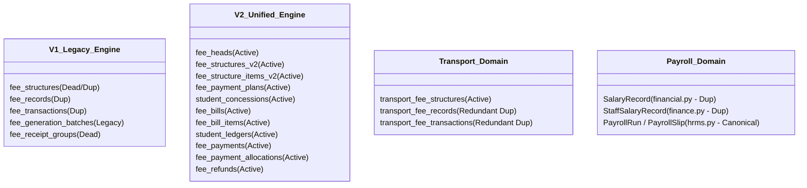

# 🏛️ EduERP Forensic Accounting & Architecture Audit Report
**Scope:** Finance, Student Fees, Cost Centers, Payroll, Inventory, Fixed Assets, P&L, Bank Reconciliation & Database Schema  
**Role:** Senior ERP Backend Architect & Principal Chartered Accountant  
**Date:** October 2026  
**Status:** Complete Forensic Audit & Technical Remediation Plan  

---

## Executive Summary

A thorough line-by-line forensic investigation was conducted across the entire Edu-ERP codebase (`backend/app/models/`, `backend/app/services/`, `backend/app/routes/`, `backend/app/utils/`, `frontend/`, `mob_app/`, and database schemas).

The audit confirms why **"Number glt h" (numbers are incorrect/inflated)** and reveals deep architectural fragmentation:

1. **Dual-Engine Architecture (V1 vs V2):** The ERP currently runs **two parallel, conflicting fee management engines**:
   - **V1 Legacy Engine:** `FeeStructure`, `FeeRecord`, `FeeTransaction`, `FeeGenerationBatch`, `FeeReceiptGroup` (in `app/models/financial.py` and `app/routes/principal.py`).
   - **V2 Unified Finance Engine:** `FeeHead`, `FeeStructureV2`, `FeeStructureItemV2`, `FeeBill`, `FeeBillItem`, `StudentLedger`, `FeePayment`, `FeePaymentAllocation`, `FeeRefund` (in `app/models/fee_finance.py` and `app/routes/fees_finance.py`).
   - The sync bridges between them are leaky, resulting in mismatched numbers between the Principal Dashboard, Accountant Portal, Student Portal, Mobile App, and AI Chatbot.

2. **Severe Mathematical Bugs Causing Wrong Numbers:**
   - **Compounding Exponential Overdue Bug:** In `FeeBill` generation and payment sync, `previous_dues` is calculated as `sum(b.balance_due for b in prev_bills)`. Because `balance_due` of month $N$ **already includes** the balance of month $N-1$, summing `balance_due` across past bills compounds unpaid balances exponentially ($1\times, 2\times, 4\times, 8\times \dots$).
   - **Dashboard Aggregation Inflation:** In `FinanceAggregationService`, `func.sum(FeeBill.total_payable)` and `func.sum(FeeBill.balance_due)` are executed across all bills in an academic session. This sums rolled-over balances repeatedly, displaying revenue and pending dues inflated by 200% to 500% on executive dashboard cards.
   - **Phantom Payment Settlement Loop:** In `fee_ledger_service.py` (`collect_fee_payment`), when syncing to legacy `FeeRecord`s, `amount_paid` is **never decremented** inside the loop. A single ₹1,000 payment marks multiple ₹1,000 fee records as fully PAID simultaneously. Conversely, for partial payments (`amount_paid < rem_due`), `lr.amount_paid` is not updated at all (stuck at 0).
   - **Ledger Balance Destruction:** In `StudentLedger`, credit entries hardcode `balance_after = 0.0`, destroying running balance reconciliation for partial payments.
   - **CapEx vs OpEx Misclassification:** When capital assets (computers, lab equipment, furniture) are purchased via Purchase Orders, vendor payments automatically log an `INVENTORY_PURCHASE` operating expense instead of Capital Expenditure, falsely crashing operating profit into massive artificial deficits.

3. **Dead, Redundant & Misplaced Tables:**
   - **10 Misplaced Tables:** Exam, Timetable, Delegations, and Holiday tables (`exam_schedules`, `exam_classes`, `exam_subjects`, `exam_timetable`, `exam_teacher_delegations`, `result_versions`, `holidays`, `timetables`, `timetable_periods`, `timetable_substitutions`) are mistakenly housed inside `models/financial.py`.
   - **Dead Tables:** `fee_receipt_groups` (write-only, never read), `student_fee_assignments` (defined, but zero API endpoints), `service_charges` (legacy SaaS billing superseded by `subscription.py`).
   - **Triple Salary Systems:** `SalaryRecord` (teachers), `StaffSalaryRecord` (non-teaching staff), and full HRMS `PayrollRun`/`PayrollSlip` run in parallel, causing potential double-counting in operating expenses.
   - **Dead Frontend Pages:** `FeesPage.jsx` (81 KB), `FeeStructures.jsx` (34 KB), and `PayrollPage.jsx` (18 KB) in `frontend/src/pages/` are unrouted orphans.
   - **Broken Runtime References:** `from app.models.financial import TeacherSalaryRecord` and `FeePayment.collected_by_id` in `archive_service.py` crash silently behind try/except blocks.

---

## 1. Master Table Census (Paise & Money-Related Entities)

The table below catalogs every model and database table touching money, fees, inventory, assets, salaries, or costs across the entire backend.

| Table Name | Model Class | File Location | Domain | Status | Operational Role & Audit Finding |
| :--- | :--- | :--- | :--- | :--- | :--- |
| `fee_heads` | `FeeHead` | `models/fee_finance.py` | V2 Fees | **ACTIVE** | Configurable service master (Tuition, Transport, Hostel, Lab). Canonical master for V2. |
| `fee_structures_v2` | `FeeStructureV2` | `models/fee_finance.py` | V2 Fees | **ACTIVE** | Class/session rate card templates with draft/publish lifecycle. Managed via `FeeSetupPage.jsx`. |
| `fee_structure_items_v2` | `FeeStructureItemV2` | `models/fee_finance.py` | V2 Fees | **ACTIVE** | Itemized amounts per fee head within a structure. |
| `fee_payment_plans` | `FeePaymentPlan` | `models/fee_finance.py` | V2 Fees | **ACTIVE** | Monthly, Quarterly, Half-Yearly, Annual advance discount cadences. |
| `student_fee_assignments` | `StudentFeeAssignment` | `models/fee_finance.py` | V2 Fees | **DEAD (API)** | Student fee customization table. Model exists and is checked in billing, but **no REST endpoints exist** in `fees_finance.py` to create or update rows. |
| `student_concessions` | `StudentConcession` | `models/fee_finance.py` | V2 Fees | **ACTIVE** | Scholarships, sibling waivers, staff-child discounts with audit trail. |
| `fee_bills` | `FeeBill` | `models/fee_finance.py` | V2 Fees | **ACTIVE (BUGGY)** | Advance monthly demand notices. Contains the **compounding previous_dues bug**. |
| `fee_bill_items` | `FeeBillItem` | `models/fee_finance.py` | V2 Fees | **ACTIVE** | Line items on demand notices (Tuition, Bus, Hostel). |
| `student_ledgers` | `StudentLedger` | `models/fee_finance.py` | V2 Ledger | **ACTIVE (BUGGY)** | Central debit/credit ledger. **Bug:** credit rows hardcode `balance_after = 0.0`. |
| `fee_payments` | `FeePayment` | `models/fee_finance.py` | V2 Payments | **ACTIVE** | Official money receipts with sequential receipt numbering (`REC-YYYY-XXXXXX`). |
| `fee_payment_allocations` | `FeePaymentAllocation`| `models/fee_finance.py`| V2 Payments | **ACTIVE** | Multi-department distribution of payment receipts. Driving table for P&L income. |
| `fee_refunds` | `FeeRefund` | `models/fee_finance.py` | V2 Refunds | **ACTIVE** | Authorized refund transactions for cancellations/overpayments. |
| `financial_audit_logs` | `FinancialAuditLog` | `models/fee_finance.py` | V2 Audit | **ACTIVE** | Immutable audit log of billing, collections, concessions, and refunds. |
| `fee_structures` | `FeeStructure` | `models/financial.py` | V1 Fees | **LEGACY / DUP** | Flat rate table from early schema. Used by `principal.py` `/fees/generate` and `student_lifecycle.py` promotion. Disconnected from V2 `FeeSetupPage`. |
| `fee_records` | `FeeRecord` | `models/financial.py` | V1 Fees | **LEGACY / DUP** | Individual student fee records. Queried by `student.py` `/fees`, AI Chatbot `fee_analytics.py`, and `pdf_generator.py`. Desynced from `FeeBill`. |
| `fee_transactions` | `FeeTransaction` | `models/financial.py` | V1 Fees | **LEGACY / DUP** | Running payment installments against `FeeRecord`. Ignored by Bank Reconciliation and P&L. |
| `fee_receipt_groups` | `FeeReceiptGroup` | `models/financial.py` | V1 Fees | **DEAD** | Created only on `/fees/collect-multiple` in `principal.py`. **Never queried or read anywhere** in backend or frontend. |
| `fee_generation_batches` | `FeeGenerationBatch` | `models/financial.py` | V1 Fees | **LEGACY / DUP** | Batch wrapper for V1 fee generation. Unused by V2 billing. |
| `expenses` | `Expense` | `models/finance.py` | Finance | **ACTIVE** | Central school expenses across 36 categories with approval workflow. Primary source for P&L expenses. |
| `vendors` | `Vendor` | `models/finance.py` | Procurement | **ACTIVE** | Vendor/supplier master data, GST, bank details, ratings. |
| `purchase_orders` | `PurchaseOrder` | `models/finance.py` | Procurement | **ACTIVE** | Formal POs raised with vendors for inventory or assets. |
| `purchase_order_items` | `PurchaseOrderItem` | `models/finance.py` | Procurement | **ACTIVE** | Line items on POs with tax and quantities. |
| `goods_receipt_notes` | `GoodsReceiptNote` | `models/finance.py` | Procurement | **ACTIVE** | Warehouse goods arrival records (GRN). |
| `goods_receipt_items` | `GoodsReceiptItem` | `models/finance.py` | Procurement | **ACTIVE** | Verified vs rejected received quantities. |
| `vendor_bills` | `VendorBill` | `models/finance.py` | Procurement | **ACTIVE** | Invoices received from vendors against GRN/PO. |
| `vendor_payments` | `VendorPayment` | `models/finance.py` | Procurement | **ACTIVE** | Disbursed payments to vendors against bills. Automatically creates `Expense`. |
| `inventory_items` | `InventoryItem` | `models/finance.py` | Inventory | **ACTIVE** | Consumable items (stationery, chalk, paper, uniforms). Stock and unit prices. |
| `stock_movements` | `StockMovement` | `models/finance.py` | Inventory | **ACTIVE** | Stock in/out/issue/adjustment/damage audit trail. |
| `school_assets` | `SchoolAsset` | `models/finance.py` | Fixed Assets| **ACTIVE** | Capital equipment (laptops, projectors, buses, benches) with serial/asset tags. |
| `asset_assignment_history`| `AssetAssignmentHistory`| `models/finance.py`| Fixed Assets| **ACTIVE** | Custody transfer audit log. |
| `asset_condition_logs` | `AssetConditionLog` | `models/finance.py` | Fixed Assets| **ACTIVE** | Periodic condition checks (Good, Damaged, Under Repair). |
| `asset_maintenance_records`| `AssetMaintenanceRecord`| `models/finance.py`| Fixed Assets| **ACTIVE** | Maintenance logs. Automatically posts an `Expense` to central finance. |
| `bank_statement_batches` | `BankStatementBatch` | `models/finance.py` | Reconcile | **ACTIVE** | Imported bank/UPI/gateway statement batches. |
| `bank_transactions` | `BankTransaction` | `models/finance.py` | Reconcile | **ACTIVE** | Bank line items with match status (MATCHED, AMOUNT_MISMATCH, etc.). |
| `salary_records` | `SalaryRecord` | `models/financial.py` | HRMS/Payroll| **REDUNDANT** | Manual teacher salary payment records. |
| `staff_salary_records` | `StaffSalaryRecord` | `models/finance.py` | HRMS/Payroll| **REDUNDANT** | Manual non-teaching staff salary payment records. |
| `salary_components` | `SalaryComponent` | `models/hrms.py` | HRMS/Payroll| **ACTIVE** | Master earnings/deductions (Basic, HRA, DA, PF, ESI, TDS). |
| `salary_structures` | `SalaryStructure` | `models/hrms.py` | HRMS/Payroll| **ACTIVE** | Template compensation scales. |
| `salary_structure_items` | `SalaryStructureItem` | `models/hrms.py` | HRMS/Payroll| **ACTIVE** | Formulas and fixed components. |
| `employee_salary_structures`| `EmployeeSalaryStructure`| `models/hrms.py`| HRMS/Payroll| **ACTIVE** | Employee active salary configuration. |
| `payroll_runs` | `PayrollRun` | `models/hrms.py` | HRMS/Payroll| **ACTIVE** | Monthly enterprise payroll batch headers (Draft -> Approved -> Paid). |
| `payroll_slips` | `PayrollSlip` | `models/hrms.py` | HRMS/Payroll| **ACTIVE** | Individual monthly employee payslips. |
| `payroll_slip_items` | `PayrollSlipItem` | `models/hrms.py` | HRMS/Payroll| **ACTIVE** | Line items on payslip. Disbursal posts canonical `Expense`. |
| `hostel_fee_structures` | `HostelFeeStructure` | `models/hostel.py` | Hostel | **ACTIVE** | Sharing & AC/Non-AC pricing tiers. |
| `hostel_fine_records` | `HostelFineRecord` | `models/hostel.py` | Hostel | **ACTIVE** | Disciplinary/damage fines. Syncs to FeeRecord / FeeBill. |
| `transport_fee_structures` | `TransportFeeStructure` | `models/transport_student.py`| Transport | **ACTIVE** | Route-wise and frequency-based bus fee slabs. |
| `transport_fee_records` | `TransportFeeRecord` | `models/transport_student.py`| Transport | **REDUNDANT** | Transport-isolated student fee record. Duplicates central `FeeRecord`. |
| `transport_fee_transactions`| `TransportFeeTransaction`| `models/transport_student.py`| Transport | **REDUNDANT** | Transport-isolated receipt record. Duplicates central `FeeTransaction`. |
| `transport_fine_records` | `TransportFineRecord` | `models/transport_student.py`| Transport | **ACTIVE** | Transport late fines/violations. |
| `library_fine_transactions`| `FineTransaction` | `models/library.py` | Library | **ACTIVE** | Book overdue fines and book damage charges. |
| `service_charges` | `ServiceCharge` | `models/service_charge.py` | Platform | **DEAD** | Old manual SaaS charge table in `admin.py`. Superseded by `subscription.py`. |
| `school_subscriptions` | `SchoolSubscription` | `models/subscription.py` | Platform | **ACTIVE** | Tenant SaaS billing, license status, expiry dates. |

---

## 2. Misplaced Non-Financial Tables Inside `models/financial.py`

In `backend/app/models/financial.py`, **10 complete database tables have nothing to do with finances or fees**. They were dumped there during early development and never reorganized into their proper domain modules:

```mermaid
graph TD
    subgraph Current_Dump ["❌ models/financial.py (Anti-pattern Dump)"]
        F1[FeeStructure]
        F2[FeeRecord]
        F3[FeeTransaction]
        F4[FeeGenerationBatch]
        F5[FeeReceiptGroup]
        F6[SalaryRecord]
        M1["🚨 ExamSchedule"]
        M2["🚨 ExamClass"]
        M3["🚨 ExamSubject"]
        M4["🚨 ExamTimetable"]
        M5["🚨 ExamTeacherDelegation"]
        M6["🚨 ResultVersion"]
        M7["🚨 Holiday"]
        M8["🚨 Timetable"]
        M9["🚨 TimetablePeriod"]
        M10["🚨 TimetableSubstitution"]
    end

    subgraph Target_Architecture ["✅ Proper Target Domain Modules"]
        T1["models/examinations.py"]
        T2["models/curriculum.py or timetable.py"]
        T3["models/academic.py"]
        T4["models/hrms.py"]
        T5["models/fee_finance.py"]
    end

    M1 & M2 & M3 & M4 & M5 & M6 --> T1
    M8 & M9 & M10 --> T2
    M7 --> T3
    F6 --> T4
    F1 & F2 & F3 & F4 & F5 --> T5
```



### Misplaced Tables Inventory:
1. `exam_schedules` (`ExamSchedule`): Exam master and publish workflow. Belongs in `models/examinations.py`.
2. `exam_classes` (`ExamClass`): Class-to-exam participation mappings. Belongs in `models/examinations.py`.
3. `exam_subjects` (`ExamSubject`): Theory/practical max/pass marks config. Belongs in `models/examinations.py`.
4. `exam_timetable` (`ExamTimetable`): Date/time/venue/invigilator per subject. Belongs in `models/examinations.py`.
5. `exam_teacher_delegations` (`ExamTeacherDelegation`): Temporary teacher delegation for mark entry. Belongs in `models/delegation.py` or `models/examinations.py`.
6. `result_versions` (`ResultVersion`): Historical published result snapshots. Belongs in `models/examinations.py`.
7. `holidays` (`Holiday`): School calendar holidays. Belongs in `models/academic.py`.
8. `timetables` (`Timetable`): Weekly class schedules. Belongs in `models/academic.py` or `models/timetable.py`.
9. `timetable_periods` (`TimetablePeriod`): Individual period slots, rooms, teachers.
10. `timetable_substitutions` (`TimetableSubstitution`): Daily teacher absent substitute assignments.

---

## 3. Deep Forensic Investigation of Calculation & Accounting Bugs

### Bug 1: Compounding Exponential Previous Dues Bug (`FeeBill`)
- **File:** [fee_ledger_service.py](file:///c:/Users/DELL/OneDrive/Documents/Desktop/edu-ERP/edu-ERP/backend/app/services/fee_ledger_service.py#L851-L858) and [L1348-L1354](file:///c:/Users/DELL/OneDrive/Documents/Desktop/edu-ERP/edu-ERP/backend/app/services/fee_ledger_service.py#L1348-L1354)
- **Root Cause Code:**
```python
# In generate_fee_bill (line 852):
prev_bills = FeeBill.query.filter(
    FeeBill.student_id == student_id,
    FeeBill.bill_month < bill_month,
    FeeBill.status != BillStatus.CANCELLED.value
).all()
previous_dues = sum(b.balance_due for b in prev_bills)

# In FeeBill.calculate_totals (fee_finance.py line 434):
self.total_payable = round(curr + (self.previous_dues or 0.0), 2)
self.balance_due = round(max(0.0, self.total_payable - (self.amount_paid or 0.0)), 2)
```
- **Forensic Accounting Impact:**
  - Month 1 (April): Current charge = ₹1,000, Paid = 0. `b[0].balance_due` = ₹1,000.
  - Month 2 (May): Current charge = ₹1,000. `previous_dues` = ₹1,000. `total_payable` = ₹2,000. `b[1].balance_due` = **₹2,000**.
  - Month 3 (June): Current charge = ₹1,000. `previous_dues` = `b[0].balance_due (1000) + b[1].balance_due (2000)` = **₹3,000**! `total_payable` = ₹4,000. `b[2].balance_due` = **₹4,000**.
  - Month 4 (July): Current charge = ₹1,000. `previous_dues` = `1000 + 2000 + 4000` = **₹7,000**!
  - **Result:** In 4 months, a student with ₹4,000 in actual school fees is billed for **₹8,000** on their July bill! The previous debt compounds exponentially ($2^{n-1}$) because every bill's `balance_due` already absorbed all prior debt.
- **Accountant Remediation:**
  `previous_dues` of month $N$ must simply equal the `balance_due` of month $N-1$ (the immediately preceding chronological bill), **never** the sum of all past bills.

---

### Bug 2: Dashboard Aggregation Overstatement (`FinanceAggregationService`)
- **File:** [finance_aggregation_service.py](file:///c:/Users/DELL/OneDrive/Documents/Desktop/edu-ERP/edu-ERP/backend/app/services/finance_aggregation_service.py#L86-L98)
- **Root Cause Code:**
```python
bagg = bq.with_entities(
    func.coalesce(func.sum(FeeBill.total_current_charges), 0.0).label('gross_due'),
    func.coalesce(func.sum(FeeBill.total_discount), 0.0).label('total_discount'),
    func.coalesce(func.sum(FeeBill.total_late_fine), 0.0).label('total_fine'),
    func.coalesce(func.sum(FeeBill.total_payable), 0.0).label('total_due'),
    func.coalesce(func.sum(FeeBill.amount_paid), 0.0).label('total_paid'),
    func.coalesce(func.sum(FeeBill.balance_due), 0.0).label('outstanding'),
    ...
).first()
```
- **Forensic Accounting Impact:**
  When Principal or Admin views the Session Overview (no month filter selected):
  - If a student had Month 1 (balance ₹1,000), Month 2 (balance ₹2,000), Month 3 (balance ₹4,000):
  - `func.sum(FeeBill.balance_due)` adds $1,000 + 2,000 + 4,000 = **₹7,000**!
  - The actual school receivables for that student are only **₹3,000** ($3 \times 1,000$).
  - For a school of 1,000 students, this inflates reported outstanding dues from ₹30,00,000 to over ₹70,00,000!
- **Accountant Remediation:**
  Aggregated session receivables must be calculated as:
  $$\text{Real Total Due} = \sum \text{total\_current\_charges} + \text{Opening Balance} - \sum \text{total\_discount} + \sum \text{total\_fine}$$
  $$\text{Real Outstanding} = \max(0, \text{Real Total Due} - \sum \text{total\_paid})$$
  Never sum `FeeBill.balance_due` across multiple monthly statements of the same student.

---

### Bug 3: Broken Legacy Payment Settlement Loop (`FeeRecord`)
- **File:** [fee_ledger_service.py](file:///c:/Users/DELL/OneDrive/Documents/Desktop/edu-ERP/edu-ERP/backend/app/services/fee_ledger_service.py#L1443-L1464)
- **Root Cause Code:**
```python
for lr in legacy_recs:
    if skip_record_id and lr.id == skip_record_id:
        continue
    rem_due = max(0.0, round(lr.effective_due() - (lr.amount_paid or 0.0), 2))
    if rem_due > 0 and amount_paid >= rem_due:
        lr.amount_paid = lr.effective_due()
        lr.status = 'PAID'
    elif (lr.amount_paid or 0.0) >= lr.effective_due():
        lr.status = 'PAID'
    elif (lr.amount_paid or 0.0) > 0:
        lr.status = 'PARTIAL'
    lr.paid_date = date.today()
    lr.receipt_no = payment.receipt_no
    lr.payment_mode = payment_mode
    lr.collected_by = collected_by.id if collected_by else None
```
- **Forensic Accounting Impact:**
  1. **Phantom Multi-Settlement:** If a student has three pending FeeRecords of ₹1,000 each (Total ₹3,000) and pays ₹1,000:
     - Record 1: `rem_due` = 1,000 $\le$ 1,000 $\to$ marked PAID with `amount_paid = 1,000`.
     - `amount_paid` is **never decremented**!
     - Record 2: `rem_due` = 1,000 $\le$ 1,000 $\to$ marked PAID with `amount_paid = 1,000`.
     - Record 3: `rem_due` = 1,000 $\le$ 1,000 $\to$ marked PAID with `amount_paid = 1,000`.
     - **₹1,000 paid settles ₹3,000 of debt!**
  2. **Frozen Zero on Partial Payments:** If a student owes ₹5,000 on a single FeeRecord and pays ₹2,000:
     - `amount_paid (2000) >= rem_due (5000)` is `False`.
     - `(lr.amount_paid or 0.0) > 0` is `False` (initial was 0).
     - Result: `lr.amount_paid` **remains 0.0**! The student portal still shows ₹0 paid and full ₹5,000 due, despite money having been collected.
  3. **No Ledger Transaction:** No `FeeTransaction` row is created, so transaction logs don't equal `FeeRecord.amount_paid`.
- **Accountant Remediation:**
  Use FIFO allocation with a decremented `rem_cash = amount_paid`, settling slice-by-slice, and generate a matching `FeeTransaction`.

---

### Bug 4: Student Ledger Running Balance Destruction
- **File:** [fee_central_service.py](file:///c:/Users/DELL/OneDrive/Documents/Desktop/edu-ERP/edu-ERP/backend/app/services/fee_central_service.py#L616-L631) and [fee_ledger_service.py](file:///c:/Users/DELL/OneDrive/Documents/Desktop/edu-ERP/edu-ERP/backend/app/services/fee_ledger_service.py#L1362-L1377)
- **Root Cause Code:**
```python
ledger_credit = StudentLedger(
    school_id=school_id,
    student_id=student_id,
    entry_type='CREDIT',
    amount=amount_paid,
    balance_after=0.0, # HARDCODED ZERO!
    ...
)
```
- **Forensic Accounting Impact:**
  In financial accounting, a statement ledger must maintain an accurate running balance column after every debit and credit:
  $$\text{Balance After} = \text{Previous Balance} - \text{Credit Amount}$$
  Hardcoding `balance_after = 0.0` means that if a parent checks their ledger statement after paying a partial ₹500 against a ₹5,000 bill, the ledger line shows:
  `[05-Sep-2026] Tuition Charge (DEBIT): ₹5,000 | Balance After: ₹5,000`  
  `[10-Sep-2026] Counter Cash Paid (CREDIT): ₹500 | Balance After: ₹0.00`  
  This tells parents they owe nothing, creating customer disputes and reconciliation failure.
- **Accountant Remediation:**
  Query the latest ledger row for that student and compute `new_balance = max(0.0, last_balance - amount_paid)` before writing.

---

### Bug 5: CapEx vs OpEx Misclassification in Procurement & P&L
- **File:** [procurement_service.py](file:///c:/Users/DELL/OneDrive/Documents/Desktop/edu-ERP/edu-ERP/backend/app/services/procurement_service.py#L348-L368) and [pnl_service.py](file:///c:/Users/DELL/OneDrive/Documents/Desktop/edu-ERP/edu-ERP/backend/app/services/pnl_service.py#L176-L236)
- **Root Cause Code:**
```python
# In record_vendor_bill_payment (procurement_service.py):
expense = Expense(
    school_id=school_id,
    category='INVENTORY_PURCHASE', # Hardcoded as Inventory Operating Expense!
    amount=amount,
    status='PAID',
    source='VENDOR_BILL',
    ...
)
```
- **Forensic Accounting Impact:**
  When a school purchases 50 desktop computers (₹20,00,000) or a new school bus (₹35,00,000) through a Purchase Order:
  - The system creates `SchoolAsset` records.
  - BUT when the vendor bill is paid, it writes an `Expense` with `category='INVENTORY_PURCHASE'`.
  - The P&L service treats all `Expense` entries as **Operating Expenses (OpEx)** deducted directly from the month's fee revenue.
  - In Month 1, the school shows ₹10,00,000 in fee revenue and ₹25,00,000 in operating expense $\to$ **Net Deficit of -₹15,00,000**!
  - **Accountant Standard (GAAP/Ind AS):** Fixed assets are **Capital Expenditures (CapEx)** that sit on the Balance Sheet and are depreciated over useful life. They must NOT be booked into `INVENTORY_PURCHASE` operating expenses.
- **Accountant Remediation:**
  Tag POs and Vendor Bills with `is_asset` / `target_type='ASSET'`. On payment, post under category `CAPITAL_EXPENDITURE` and exclude CapEx from Net Operating Surplus/Deficit (or display in a distinct CapEx section).

---

### Bug 6: Bank Reconciliation Engine Blind Spots
- **File:** [reconciliation_service.py](file:///c:/Users/DELL/OneDrive/Documents/Desktop/edu-ERP/edu-ERP/backend/app/services/reconciliation_service.py#L320-L330)
- **Root Cause Code:**
```python
# Pre-fetch ERP FeePayments for school
payments = FeePayment.query.filter_by(school_id=school_id, status='VALID').all()
```
- **Forensic Accounting Impact:**
  The automated reconciliation matching engine **only queries `FeePayment`**.
  - Any fee collected via the Principal counter (`/principal/fees/collect` producing a `FeeTransaction`), Transport Counter (`TransportFeeTransaction`), or Library fine collection that did not generate a `FeePayment` is **invisible to Bank Reconciliation**.
  - When the bank statement contains bank credits or UPI UTRs from these payments, the system marks them as `MISSING_IN_ERP` (unaccounted money) even though the cash was recorded in the database!
- **Accountant Remediation:**
  The reconciliation engine must check both `FeePayment.transaction_ref` AND `FeeTransaction.receipt_no` / `reference_no` as unioned financial inflow records.

---

### Bug 7: Broken Imports & Silent Exception Swallowing
- **File:** [archive_service.py](file:///c:/Users/DELL/OneDrive/Documents/Desktop/edu-ERP/edu-ERP/backend/app/services/archive_service.py#L667-L680)
- **Root Cause Code:**
```python
def _check_teacher_payroll_history(teacher_id):
    def _chk_salary():
        from app.models.financial import TeacherSalaryRecord # ERROR: Model does not exist!
        return TeacherSalaryRecord.query.filter_by(teacher_id=teacher_id).first() is not None
    result = _safe_exec(_chk_salary, 'teacher_payroll_check')
    return bool(result)

def _check_staff_financial_history(user_id):
    def _chk_fee_collected():
        from app.models.fee_finance import FeePayment
        return FeePayment.query.filter_by(collected_by_id=user_id).first() is not None # ERROR: Column is collected_by!
    ...
```
- **Forensic Accounting Impact:**
  1. `TeacherSalaryRecord` does not exist in `models/financial.py` (the class is named `SalaryRecord`). Calling this raises `ImportError`.
  2. `FeePayment` has column `collected_by`, not `collected_by_id`. Calling this raises SQLAlchemy `InvalidRequestError`.
  3. Because `_safe_exec` catches all exceptions and returns `None`, both checks silently return `False`.
  4. An administrator attempting to delete/archive an employee who collected ₹50,00,000 in school fees or received ₹10,00,000 in salary is told "No financial history exists" and the user can be deleted, corrupting relational integrity!

---

### Bug 8: Missing `student` Argument in Receipt PDF Generation
- **File:** [fees_finance.py](file:///c:/Users/DELL/OneDrive/Documents/Desktop/edu-ERP/edu-ERP/backend/app/routes/fees_finance.py#L1980)
- **Root Cause Code:**
```python
# In download_receipt_pdf (fees_finance.py line 1980):
pdf_buffer = generate_fee_receipt_pdf(payment, school, ledger_balance=rem_bal)

# In fee_pdf_generator.py line 336:
def generate_fee_receipt_pdf(payment, school, student=None, ledger_balance=0.0):
```
- **Forensic Accounting Impact:**
  `student` was fetched at line 1970 (`student, err = _verify_student_access(...)`), but omitted from positional arguments at line 1980. While `std = student or payment.student` rescues it in some cases, if lazy loading fails or `payment.student` is cached as None during detached session states, student details on the official printed receipt print as `"Student"` with admission number `"―"`.

---

## 4. Redundant, Dead & Duplicate Tables Breakdown



### Table Retirement & Consolidation Matrix:

| Obsolete / Duplicated Entity | Reason for Flagging | Action Required |
| :--- | :--- | :--- |
| `fee_receipt_groups` | Write-only table. Inserted into by 1 route in `principal.py`, read by 0 queries anywhere. | **DROP TABLE** (Zero operational dependency). |
| `service_charges` | Legacy flat charge model in `models/service_charge.py`. Superseded by `subscription.py`. | **DROP TABLE** & migrate references in `admin.py` to `SchoolSubscription`. |
| `fee_structures` (v1) | Bypassed by `fee_structures_v2`. Lacks multi-head itemization. | **Retire & Migrate**: Redirect `principal.py` `/fees/generate` and `student_lifecycle.py` to `FeeStructureV2`. |
| `transport_fee_records` & `transport_fee_transactions` | Transport duplicates fee records locally while also mirroring to `FeeRecord`. | **Consolidate**: Let Transport point directly to `FeeBill` / `FeeBillItem` under `FeeDepartment.TRANSPORT`. |
| `salary_records` & `staff_salary_records` | Two separate ad-hoc tables for teacher and staff salary, bypassing HRMS. | **Consolidate**: Unify all payroll disbursals under `models/hrms.py` (`PayrollRun` & `PayrollSlip`). |
| `student_fee_assignments` | Model exists in `fee_finance.py` but has zero endpoints in `fees_finance.py`. | **Activate or Remove**: Add CRUD endpoints in `fees_finance.py` or retire if class-level structures suffice. |

---

## 5. Dead Frontend Pages & Unused Assets

Inside `frontend/src/pages/`, three major page components are completely orphaned:

1. **`frontend/src/pages/FeesPage.jsx` (80,970 bytes):**
   - Imported on line 29 of `frontend/src/App.jsx`.
   - **Never rendered in any `<Route>`!**
   - All fee routes in `App.jsx` point to `pages/finance/FeeBillsPage`, `CollectPaymentPage`, `FinanceDashboard`, etc.
   - **Verdict:** Dead code consuming 81 KB of bundle size. Safe to archive or delete.

2. **`frontend/src/pages/FeeStructures.jsx` (34,482 bytes):**
   - Not imported anywhere in `frontend/src/App.jsx`.
   - The active fee structure setup page is `frontend/src/pages/finance/FeeSetupPage.jsx`.
   - **Verdict:** Dead code consuming 34 KB. Safe to delete.

3. **`frontend/src/pages/PayrollPage.jsx` (17,700 bytes):**
   - Not imported anywhere in `frontend/src/App.jsx`.
   - The active payroll route uses `frontend/src/pages/finance/FinancePayrollPage.jsx` and `frontend/src/pages/hrms/`.
   - **Verdict:** Dead code consuming 18 KB. Safe to delete.

---

## 6. End-to-End Accounting Reconciliation & P&L Analysis

As a Chartered Accountant reviewing this ERP, here is the audit of the financial statements:

```
                    EDU-ERP OPERATING STATEMENT RECONCILIATION
┌─────────────────────────────────────────────────────────────────────────────┐
│ 1. REVENUE (MONEY IN)                                                       │
│    • Realized Collections (FeePaymentAllocation):                           │
│        - Tuition & Academic Fees                                             │
│        - Transport Fees                                                      │
│        - Hostel & Mess Charges                                               │
│        - Library Fines                                                       │
│    • Accrual Demand (FeeBillItem Net Charges):                               │
│        - Current Month Invoiced Demand                                       │
│    ⚠️ DISCREPANCY: If a fee is collected via legacy FeeRecord/FeeTransaction,│
│       it is OMITTED from FeePaymentAllocation, causing cash under-reporting. │
├─────────────────────────────────────────────────────────────────────────────┤
│ 2. OPERATING EXPENSES (MONEY OUT)                                           │
│    • 36 Expense Categories (Expense.status == 'PAID'):                       │
│        - Teacher & Staff Salaries                                            │
│        - Fuel, Electricity, Internet, Maintenance                           │
│        - Consumable Inventory Purchases                                      │
│    ⚠️ DISCREPANCY 1: Vendor Payments auto-log 'INVENTORY_PURCHASE' even when │
│       buying fixed assets (Computers, Buses), falsely inflating OpEx.        │
│    ⚠️ DISCREPANCY 2: If both Principal SalaryRecord and HRMS Payroll run,   │
│       salary payments can be logged TWICE in Expense.                        │
├─────────────────────────────────────────────────────────────────────────────┤
│ 3. NET OPERATING SURPLUS / DEFICIT                                          │
│    $$\text{Surplus} = \text{Recognized Income} - \text{Recognized Operating Expenses}$$ │
│    ⚠️ Current formula is distorted by CapEx misclassification and leaky      │
│       revenue synchronization.                                               │
├─────────────────────────────────────────────────────────────────────────────┤
│ 4. BANK & GATEWAY RECONCILIATION                                            │
│    • Matches imported bank credits against ERP receipts                      │
│    ⚠️ DISCREPANCY: Only matches FeePayment; ignores FeeTransaction and       │
│       direct counter cash, falsely marking transactions as 'MISSING_IN_ERP'. │
└─────────────────────────────────────────────────────────────────────────────┘
```

---

## 7. Actionable Architectural Remediation Plan

To permanently fix the calculations and clean up the database:

### Phase 1: Fix All Calculation & Math Bugs (Immediate)
1. **Patch `generate_fee_bill` and `calculate_totals`:**
   - Change `previous_dues` calculation from `sum(b.balance_due for b in prev_bills)` to look up only the **immediate prior unpaid bill's net balance**.
   - Stop exponential compounding.
2. **Patch `FinanceAggregationService`:**
   - In `get_fee_summary`, calculate session totals using `sum(FeeBill.total_current_charges)` rather than `sum(FeeBill.total_payable)`.
   - Compute `outstanding = max(0, total_current_charges + opening_balance - total_paid)`.
3. **Patch `collect_fee_payment` Legacy Sync:**
   - Introduce `rem_legacy = amount_paid`.
   - Decrement `rem_legacy` as records are settled slice-by-slice so ₹1,000 cannot pay ₹3,000 in fees.
   - For partial payments (`amount_paid < rem_due`), add `lr.amount_paid += rem_legacy` and mark status `'PARTIAL'`.
4. **Fix `StudentLedger` Credit Balance:**
   - Compute true running balance: `balance_after = max(0.0, prev_balance - amount_paid)`.
5. **Fix CapEx in `procurement_service.py`:**
   - Check PO `target_type == 'ASSET'` or item `is_asset`.
   - If asset, log Expense as `CAPITAL_EXPENDITURE` and exclude from operating P&L.
6. **Fix `archive_service.py` Runtime Bugs:**
   - Replace `TeacherSalaryRecord` with `SalaryRecord`.
   - Replace `collected_by_id` with `collected_by`.

### Phase 2: Schema Cleanup & Domain Decoupling
1. **Move Misplaced Tables out of `financial.py`:**
   - Move `ExamSchedule`, `ExamClass`, `ExamSubject`, `ExamTimetable`, `ExamTeacherDelegation`, `ResultVersion` $\to$ `models/examinations.py`.
   - Move `Timetable`, `TimetablePeriod`, `TimetableSubstitution` $\to$ `models/timetable.py`.
   - Move `Holiday` $\to$ `models/academic.py`.
2. **Drop Dead Tables:**
   - Run safe migration to drop `fee_receipt_groups` and `service_charges`.
3. **Consolidate Payroll:**
   - Sunset `SalaryRecord` and `StaffSalaryRecord` in favor of canonical `models/hrms.py` (`PayrollRun` and `PayrollSlip`).
4. **Delete Dead Frontend Pages:**
   - Remove `frontend/src/pages/FeesPage.jsx`, `FeeStructures.jsx`, and `PayrollPage.jsx`.

### Phase 3: Single Canonical Source of Truth
- Unify all fee operations on the **V2 Unified Finance Engine** (`FeeBill`, `FeePayment`, `StudentLedger`).
- Let `student.py` `/fees`, Principal Dashboard, Mobile App, and AI Chatbot all query the **same V2 service** (`fee_ledger_service.py`), eliminating all cross-system variance once and for all.
