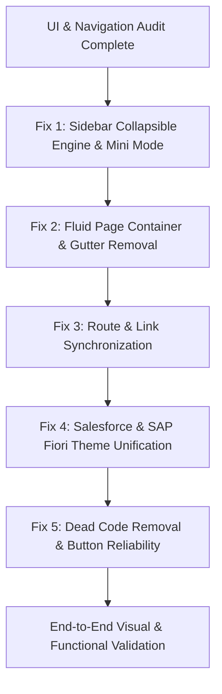

# EduERP UI/Frontend Architectural, Role Navigation, & Forensic Bugs Audit
**Document Version:** 1.0.0  
**Target Application:** EduERP (1P360) Multi-Tenant Enterprise Web Platform  
**Design Standards:** Salesforce Lightning Design System (SLDS) & SAP Fiori Enterprise Tokens  
**Date of Audit:** October 21, 2026  

---    

## 1. Executive Summary & UI Health Scorecard

A complete forensic audit of the EduERP frontend codebase (`frontend/src/`) was conducted. The audit focused on:
1. **Wrong API Connections & Route Desynchronization:** Broken navigation paths, invalid endpoints, and multi-tenant routing mismatches.
2. **Dead Code & Legacy Shims:** Unused components, unreferenced views, and broken redirect wrappers.
3. **Design System & Color Inconsistencies:** Deviation from Salesforce Lightning (`#0176d3`, `#014486`, `#f3f2f2`) and SAP Fiori design standards due to rogue Tailwind hex colors.
4. **Layout Flaws ("Dono Side Jagah Khaali"):** Artificial hardcoded `maxWidth` containers (900px, 1400px, 1440px) with `margin: 0 auto` causing 120px–440px empty white gutters on 1080p and 2K/4K displays.
5. **Sidebar Rigidity & Lack of Interactivity:** Hardcoded 232px sidebar width with **zero collapse/expand functionality**, missing mini-icon mode, and lack of smooth CSS transitions.
6. **Role-by-Role Sidebar Navigation:** Item-by-item verification across all 11 system roles (`SUPER_ADMIN`, `PRINCIPAL`, `TEACHER`, `ACCOUNTANT`, `LIBRARIAN`, `HOSTEL`, `TRANSPORT`, `DRIVER`, `STUDENT`, `PARENT`, `EMPLOYEE`).

### Overall UI Health Scorecard
| Metric | Status | Score | Primary Defect |
| :--- | :---: | :---: | :--- |
| **Route Integrity & Canonical Mapping** | ⚠️ Warning | 72 / 100 | Super Admin & Employee paths hitting 404s (`/schools`, `/users`, `/developer/errors`, `/support/kb`). |
| **API Endpoints & Integration** | ⚠️ Warning | 76 / 100 | Dead redirect shims (`FeesPage`, `FeeStructures`, `PayrollPage`) crash with `SchoolMismatchPage`. |
| **Design System & Color Tokens** | ❌ Critical | 48 / 100 | Salesforce/SAP tokens defined in `index.css` are ignored; 20+ pages hardcode arbitrary hex codes (`#2563eb`, `#3730a3`, `#15803d`). |
| **Layout & Screen Responsiveness** | ❌ Critical | 54 / 100 | Wide-screen gutter gaps caused by inline `maxWidth: 1440px; margin: 0 auto`. |
| **Sidebar Interactivity & Collapsibility** | ❌ Critical | 40 / 100 | No collapse toggle, no mini-sidebar mode (70px), hardcoded width 232px vs CSS variable 240px. |
| **Button & Form Action Reliability** | ⚠️ Warning | 68 / 100 | Native blocking `alert(...)` popups, buttons without `type="button"` in forms, dead download buttons. |
| **Overall Frontend UI Health** | **POOR** | **59.7 / 100** | **Requires Comprehensive Architectural Remediation** |

---

## 2. Role-by-Role Sidebar Inventory & Link Audit

The application defines 11 distinct navigation configurations in [Sidebar.jsx](file:///c:/Users/DELL/OneDrive/Documents/Desktop/edu-ERP/edu-ERP/frontend/src/components/Sidebar.jsx). Below is the comprehensive audit for each role.

### 2.1 Role: `SUPER_ADMIN` (Platform Administrator / SaaS Owner)
Configured in `ROLE_MENUS.SUPER_ADMIN` ([Sidebar.jsx:8-70](file:///c:/Users/DELL/OneDrive/Documents/Desktop/edu-ERP/edu-ERP/frontend/src/components/Sidebar.jsx#L8-L70)).

| Menu Group | Menu Label | Configured Path | Canonical Resolved Path | Target Route in App.jsx | Status | Forensic Finding / Bug |
| :--- | :--- | :--- | :--- | :--- | :---: | :--- |
| **Overview** | Dashboard | `/dashboard` | `/admin/dashboard` | `/admin/dashboard` | ✅ OK | Correctly resolves via `resolveTenantPath`. |
| **Management** | Schools | `/schools` | `/schools` | `/admin/schools` | ❌ **404 BUG** | `resolveTenantPath` returns `/schools`, but `App.jsx` line 186 defines `/admin/schools`. Clicking "Schools" triggers **404 Not Found Page**! |
| **Management** | Users | `/users` | `/users` | `/admin/users` | ❌ **404 BUG** | `resolveTenantPath` returns `/users`, but `App.jsx` line 188 defines `/admin/users`. Clicking "Users" triggers **404 Not Found Page**! |
| **Access Control** | Role Management | `/rbac/roles` | `/app/admin/rbac/roles` | `/:schoolSlug/:role/rbac/roles` | ⚠️ Risk | Canonical URL works, but legacy redirect `/rbac/roles` redirects to `/admin/rbac/roles` (which does not exist in `App.jsx`). |
| ↳ *Sub-item* | Roles & Hierarchy | `/rbac/roles` | `/app/admin/rbac/roles` | `/:schoolSlug/:role/rbac/roles` | ⚠️ Risk | Same legacy redirect mismatch. |
| ↳ *Sub-item* | Permission Matrix | `/rbac/permissions` | `/app/admin/rbac/permissions` | `/:schoolSlug/:role/rbac/permissions` | ⚠️ Risk | Same legacy redirect mismatch. |
| ↳ *Sub-item* | Delegations | `/rbac/delegations` | `/app/admin/delegations` | `/:schoolSlug/:role/delegations` | ✅ OK | Normalized via `normalizeServiceAlias`. |
| **Access Control** | Audit Logs | `/audit/company/logs` | `/app/admin/audit/company/logs` | `/audit/company/logs` | ❌ **404 BUG** | `resolveTenantPath` prefixes `/app/admin/...`, but `App.jsx` line 195 defines root route `/audit/company/logs`. Sidebar link fails with **404**! |
| ↳ *Sub-item* | Company Audit Logs | `/audit/company/logs` | `/app/admin/audit/company/logs` | `/audit/company/logs` | ❌ **404 BUG** | Same 404 routing error. |
| ↳ *Sub-item* | School Audit Logs | `/audit/school/logs` | `/app/admin/audit-logs` | `/:schoolSlug/:role/audit-logs` | ✅ OK | Normalized via `normalizeServiceAlias`. |
| **Customer Service** | Support Dashboard | `/developer/support` | `/developer/support` | `/developer/support` | ✅ OK | Correctly matches route. |
| ↳ *Sub-item* | All Tickets | `/developer/support` | `/developer/support` | `/developer/support` | ✅ OK | Correctly matches route. |
| ↳ *Sub-item* | Support Inbox | `/support/tickets` | `/app/admin/support/tickets` | `/:schoolSlug/:role/support/tickets` | ✅ OK | Allowed for Super Admin. |
| ↳ *Sub-item* | Meetings | `/support/meetings` | `/app/admin/support/meetings` | `/:schoolSlug/:role/support/meetings` | ✅ OK | Allowed for Super Admin. |
| ↳ *Sub-item* | Announcements | `/support/announcements` | `/app/admin/announcements` | `/:schoolSlug/:role/announcements` | ✅ OK | Normalized to `announcements`. |
| ↳ *Sub-item* | Knowledge Base | `/support/kb` | `/app/admin/support/kb` | `/help-center` | ❌ **404 DEAD LINK** | Route `/support/kb` does NOT exist in `App.jsx`! Mounted at `/help-center`. Clicking results in **404**! |
| **Customer Service** | Demo Requests | `/developer/leads` | `/developer/leads` | `/developer/leads` | ✅ OK | Correctly matches route. |
| **Developer Tools** | Error Center | `/developer/errors` | `/developer/errors` | `/developer/errors` | ✅ OK | Correctly matches route. |
| **Developer Tools** | Issue Board | `/developer/issues` | `/developer/issues` | `/developer/issues` | ✅ OK | Correctly matches route. |
| **Developer Tools** | System Health | `/developer/system-health` | `/developer/system-health` | `/developer/system-health` | ✅ OK | Correctly matches route. |
| **Developer Tools** | 1P360 BOT Config | `/developer/ai` | `/developer/ai` | `/developer/ai` | ✅ OK | Correctly matches route. |

---

### 2.2 Role: `PRINCIPAL` (and equivalents: `DIRECTOR`, `VICE_PRINCIPAL`)
Configured in `ROLE_MENUS.PRINCIPAL` ([Sidebar.jsx:72-284](file:///c:/Users/DELL/OneDrive/Documents/Desktop/edu-ERP/edu-ERP/frontend/src/components/Sidebar.jsx#L72-L284)).

| Menu Group / Suite | Menu Label | Configured Path | Target Route in App.jsx | Status | Forensic Finding / Bug |
| :--- | :--- | :--- | :--- | :---: | :--- |
| **Core** | Dashboard | `/dashboard` | `/:schoolSlug/principal/dashboard` | ✅ OK | Verified. |
| **Student Management** | Students Directory | `/students` | `/:schoolSlug/principal/students` | ✅ OK | Verified. |
| ↳ *Sub-item* | New Admission | `/admission` | `/:schoolSlug/principal/admission` | ✅ OK | Verified. |
| ↳ *Sub-item* | Provisional Admissions | `/admissions/provisional` | `/:schoolSlug/principal/admissions/provisional` | ✅ OK | Verified. |
| ↳ *Sub-item* | Students Bulk Edit | `/students/bulk-edit` | `/:schoolSlug/principal/students/bulk-edit` | ✅ OK | Verified. |
| ↳ *Sub-item* | Section Shuffle | `/students/section-shuffle` | `/:schoolSlug/principal/students/section-shuffle` | ✅ OK | Verified. |
| ↳ *Sub-item* | Promote & Rollover | `/students/promotion` | `/:schoolSlug/principal/students/promotion` | ✅ OK | Verified. |
| ↳ *Sub-item* | Annual Re-Registration | `/students/annual-register` | `/:schoolSlug/principal/students/annual-register` | ✅ OK | Verified. |
| ↳ *Sub-item* | Bulk Import CSV | `/students/import` | `/:schoolSlug/principal/students/import` | ✅ OK | Verified. |
| ↳ *Sub-item* | ID Cards | `/id-cards/students` | `/:schoolSlug/principal/id-cards/:type` | ✅ OK | Matched by `:type = students`. |
| **Academics** | Attendance | `/attendance` | `/:schoolSlug/principal/attendance` | ✅ OK | Verified. |
| ↳ *Sub-item* | Classes & Sections | `/classes` | `/:schoolSlug/principal/classes` | ✅ OK | Verified. |
| ↳ *Sub-item* | Subject Management | `/subjects` | `/:schoolSlug/principal/subjects` | ✅ OK | Verified. |
| ↳ *Sub-item* | Timetable | `/timetable` | `/:schoolSlug/principal/timetable` | ✅ OK | Verified. |
| ↳ *Sub-item* | Curriculum & Books | `/curriculum/setup` | `/:schoolSlug/principal/curriculum/setup` | ✅ OK | Verified. |
| ↳ *Sub-item* | Teacher Teaching Diary | `/curriculum/diary` | `/:schoolSlug/principal/curriculum/diary` | ✅ OK | Verified. |
| ↳ *Sub-item* | Syllabus Coverage | `/curriculum/dashboard` | `/:schoolSlug/principal/curriculum/dashboard` | ✅ OK | Verified. |
| **Academic Resources** | Notes & Study Material | `/notes` | `/:schoolSlug/principal/notes` | ✅ OK | Verified. |
| ↳ *Sub-item* | Assignments | `/assignments` | `/:schoolSlug/principal/assignments` | ✅ OK | Verified. |
| ↳ *Sub-item* | Internal Marks | `/internal-marks` | `/:schoolSlug/principal/internal-marks` | ✅ OK | Verified. |
| **Examinations** | Exam Schedule | `/exams` | `/:schoolSlug/principal/exams` | ✅ OK | Verified. |
| ↳ *Sub-item* | Marks | `/marks` | `/:schoolSlug/principal/marks` | ✅ OK | Verified. |
| ↳ *Sub-item* | Mark Entry | `/mark-entry` | `/:schoolSlug/principal/mark-entry` | ✅ OK | Points to `ResultManagement.jsx`. |
| ↳ *Sub-item* | Result Management | `/result-management` | `/:schoolSlug/principal/result-management` | ✅ OK | Verified. |
| ↳ *Sub-item* | Admit Cards | `/admit-card` | `/:schoolSlug/principal/admit-card` | ✅ OK | Verified. |
| ↳ *Sub-item* | Result Cards | `/result-card` | `/:schoolSlug/principal/result-card` | ✅ OK | Verified. |
| **Student Documents** | Issue Certificates | `/issue-documents` | `/:schoolSlug/principal/issue-documents` | ✅ OK | Verified. |
| ↳ *Sub-item* | Documents & KYC | `/documents` | `/:schoolSlug/principal/documents` | ✅ OK | Verified. |
| **Staff & HRMS** | HRMS Command Center | `/hrms` | `/:schoolSlug/principal/hrms` | ✅ OK | Verified. |
| ↳ *Sub-item* | Employee Directory | `/hrms/employees` | `/:schoolSlug/principal/hrms/employees` | ✅ OK | Verified. |
| ↳ *Sub-item* | GPS Attendance | `/staff/attendance` | `/:schoolSlug/principal/staff/attendance` | ✅ OK | Verified. |
| ↳ *Sub-item* | Leaves & Official Duty | `/hrms/leaves` | `/:schoolSlug/principal/hrms/leaves` | ✅ OK | Verified. |
| ↳ *Sub-item* | Payroll & Payslips | `/hrms/payroll` | `/:schoolSlug/principal/hrms/payroll` | ✅ OK | Verified. |
| ↳ *Sub-item* | Attendance Analytics | `/staff/attendance/analytics` | `/:schoolSlug/principal/staff/attendance/analytics` | ✅ OK | Verified. |
| ↳ *Sub-item* | Attendance Settings | `/staff/attendance/settings` | `/:schoolSlug/principal/staff/attendance/settings` | ✅ OK | Verified. |
| **Staff Delegation** | Delegations Overview | `/delegations` | `/:schoolSlug/principal/delegations` | ✅ OK | Verified. |
| ↳ *Sub-item* | Assign Substitute | `/delegations?action=new` | `/:schoolSlug/principal/delegations?action=new` | ✅ OK | Query param passed cleanly. |
| ↳ *Sub-item* | Active Delegations | `/delegations?tab=ACTIVE` | `/:schoolSlug/principal/delegations?tab=ACTIVE` | ✅ OK | Query param passed cleanly. |
| ↳ *Sub-item* | Scheduled Delegations | `/delegations?tab=SCHEDULED` | `/:schoolSlug/principal/delegations?tab=SCHEDULED` | ✅ OK | Query param passed cleanly. |
| ↳ *Sub-item* | Delegation History | `/delegations?tab=EXPIRED` | `/:schoolSlug/principal/delegations?tab=EXPIRED` | ✅ OK | Query param passed cleanly. |
| **Finance & Fees** | Dashboard | `/finance/dashboard` | `/:schoolSlug/principal/finance/dashboard` | ✅ OK | Verified. |
| ↳ *Sub-item* | Generate Monthly Fees | `/finance/generate-fees` | `/:schoolSlug/principal/finance/generate-fees` | ✅ OK | Opens `FeeBillsPage` with generate modal. |
| ↳ *Sub-item* | Fee Setup & Plans | `/finance/setup` | `/:schoolSlug/principal/finance/setup` | ✅ OK | Verified. |
| ↳ *Sub-item* | Fee Bills & Demands | `/finance/bills` | `/:schoolSlug/principal/finance/bills` | ✅ OK | Verified. |
| ↳ *Sub-item* | Collect Payment | `/finance/payments/collect` | `/:schoolSlug/principal/finance/payments/collect` | ✅ OK | Verified. |
| ↳ *Sub-item* | Payment Logs | `/finance/payment-logs` | `/:schoolSlug/principal/finance/payment-logs` | ✅ OK | Verified. |
| ↳ *Sub-item* | Outstanding Dues | `/finance/outstanding` | `/:schoolSlug/principal/finance/outstanding` | ✅ OK | Verified. |
| ↳ *Sub-item* | Reconciliation | `/finance/reconciliation` | `/:schoolSlug/principal/finance/reconciliation` | ✅ OK | Verified. |
| ↳ *Sub-item* | Expenses | `/finance/expenses` | `/:schoolSlug/principal/finance/expenses` | ✅ OK | Verified. |
| ↳ *Sub-item* | Purchases | `/finance/purchases` | `/:schoolSlug/principal/finance/purchases` | ✅ OK | Verified. |
| ↳ *Sub-item* | Inventory | `/finance/inventory` | `/:schoolSlug/principal/finance/inventory` | ✅ OK | Verified. |
| ↳ *Sub-item* | Vendors | `/finance/vendors` | `/:schoolSlug/principal/finance/vendors` | ✅ OK | Verified. |
| ↳ *Sub-item* | Assets | `/finance/assets` | `/:schoolSlug/principal/finance/assets` | ✅ OK | Verified. |
| ↳ *Sub-item* | Reports | `/finance/reports` | `/:schoolSlug/principal/finance/reports` | ✅ OK | Verified. |
| **Transport** | 12 Sub-items | `/transport/*` | `/:schoolSlug/principal/transport/*` | ✅ OK | All 12 routes resolve cleanly. |
| **Hostel** | 14 Sub-items | `/hostel/*` | `/:schoolSlug/principal/hostel/*` | ✅ OK | All 14 routes resolve cleanly. |
| **Library** | 7 Sub-items | `/library/*` | `/:schoolSlug/principal/library/*` | ✅ OK | All 7 routes resolve cleanly. |
| **Communication** | Notification Center | `/notifications/center` | `/:schoolSlug/principal/notifications/center` | ✅ OK | Verified. |
| ↳ *Sub-item* | Announcements | `/announcements` | `/:schoolSlug/principal/announcements` | ✅ OK | Verified. |
| ↳ *Sub-item* | Messages | `/messages` | `/:schoolSlug/principal/messages` | ✅ OK | Verified. |
| **AI Assistant** | 1P360 BOT | `/ai/chat` | `/:schoolSlug/principal/ai/chat` | ✅ OK | Verified. |
| **Audit Logs** | 6 Sub-items | `/audit/school/logs*` | `/:schoolSlug/principal/audit-logs*` | ✅ OK | Normalized via `normalizeServiceAlias`. |
| **Deleted Items** | Deleted Items | `/principal/deleted-items` | `/:schoolSlug/principal/deleted-items` | ✅ OK | Normalized to `deleted-items`. |
| **ERP Support** | Support Suite | `/support/*` | `/:schoolSlug/principal/support/*` | ✅ OK | Verified. |
| **Settings** | School Settings | `/school-settings` | `/:schoolSlug/principal/school-settings` | ✅ OK | Verified. |
| ↳ *Sub-item* | WhatsApp Integration | `/settings/whatsapp` | `/:schoolSlug/principal/settings/whatsapp` | ✅ OK | Verified. |
| ↳ *Sub-item* | My Plan & Services | `/my-services` | `/:schoolSlug/principal/my-services` | ✅ OK | Verified. |
| **Omission Bug** | Teachers Directory | `/teachers` | `/:schoolSlug/principal/teachers` | ❌ **MISSING** | `TeachersPage` is mounted in `App.jsx`, but **completely missing from the Principal sidebar**! |

---

### 2.3 Role: `TEACHER`
Configured in `ROLE_MENUS.TEACHER` ([Sidebar.jsx:286-330](file:///c:/Users/DELL/OneDrive/Documents/Desktop/edu-ERP/edu-ERP/frontend/src/components/Sidebar.jsx#L286-L330)).

| Menu Group | Menu Label | Configured Path | Target Route in App.jsx | Status | Forensic Finding / Bug |
| :--- | :--- | :--- | :--- | :---: | :--- |
| **Overview** | Dashboard | `/dashboard` | `/:schoolSlug/teacher/dashboard` | ✅ OK | Verified. |
| **Academics** | Today's Teaching Diary | `/curriculum/diary` | `/:schoolSlug/teacher/curriculum/diary` | ✅ OK | Verified. |
| ↳ *Item* | My Syllabus Progress | `/curriculum/coverage` | `/:schoolSlug/teacher/curriculum/coverage` | ✅ OK | Verified. |
| ↳ *Item* | Notes & Materials | `/notes` | `/:schoolSlug/teacher/notes` | ✅ OK | Verified. |
| ↳ *Item* | Assignments | `/assignments` | `/:schoolSlug/teacher/assignments` | ✅ OK | Verified. |
| ↳ *Item* | Internal Marks | `/internal-marks` | `/:schoolSlug/teacher/internal-marks` | ✅ OK | Verified. |
| ↳ *Item* | Timetable | `/timetable` | `/:schoolSlug/teacher/timetable` | ✅ OK | Verified. |
| **My Work** | My HR & Self-Service | `/my-hr` | `/:schoolSlug/teacher/my-hr` | ✅ OK | Points to `StaffSelfService.jsx`. |
| ↳ *Item* | My GPS Attendance | `/my-hr` | `/:schoolSlug/teacher/my-hr` | ⚠️ Duplicate | Duplicate link pointing to `/my-hr` without tab anchor. |
| ↳ *Item* | Student Attendance | `/attendance` | `/:schoolSlug/teacher/attendance` | ✅ OK | Teacher can mark attendance. |
| ↳ *Item* | Exam Marks Entry | `/marks` | `/:schoolSlug/teacher/marks` | ✅ OK | Verified. |
| ↳ *Item* | Result Submission | `/mark-entry` | `/:schoolSlug/teacher/mark-entry` | ✅ OK | Verified. |
| ↳ *Item* | Issue Certificates | `/issue-documents` | `/:schoolSlug/teacher/issue-documents` | ✅ OK | Verified. |
| ↳ *Item* | Student KYC Docs | `/documents` | `/:schoolSlug/teacher/documents` | ✅ OK | Verified. |
| ↳ *Item* | My Students | `/students` | `/:schoolSlug/teacher/students` | ✅ OK | Verified. |
| **Customer Service** | My Tickets | `/support/tickets` | `/:schoolSlug/teacher/support/tickets` | ✅ OK | Verified. |
| ↳ *Item* | Announcements | `/support/announcements` | `/:schoolSlug/teacher/announcements` | ✅ OK | Normalized to `announcements`. |
| ↳ *Item* | Messages | `/messages` | `/:schoolSlug/teacher/messages` | ✅ OK | Verified. |
| ↳ *Item* | Help Center | `/help-center` | `/:schoolSlug/teacher/help-center` | ✅ OK | Verified. |
| **AI Assistant** | 1P360 BOT | `/ai/chat` | `/:schoolSlug/teacher/ai/chat` | ✅ OK | Verified. |

---

### 2.4 Role: `ACCOUNTANT`
Configured in `ROLE_MENUS.ACCOUNTANT` ([Sidebar.jsx:358-390](file:///c:/Users/DELL/OneDrive/Documents/Desktop/edu-ERP/edu-ERP/frontend/src/components/Sidebar.jsx#L358-L390)).

| Menu Group | Menu Label | Configured Path | Target Route in App.jsx | Status | Forensic Finding / Bug |
| :--- | :--- | :--- | :--- | :---: | :--- |
| **Overview** | Finance Dashboard | `/finance/dashboard` | `/:schoolSlug/accountant/finance/dashboard` | ✅ OK | Verified. |
| **Finance & Fees** | 14 Financial Modules | `/finance/*` | `/:schoolSlug/accountant/finance/*` | ✅ OK | All 14 modules match routes. |
| **Customer Service** | Support Suite | `/support/tickets`, `/messages`, `/help-center` | `/:schoolSlug/accountant/*` | ✅ OK | Verified. |

---

### 2.5 Role: `LIBRARIAN`
Configured in `ROLE_MENUS.LIBRARIAN` ([Sidebar.jsx:332-356](file:///c:/Users/DELL/OneDrive/Documents/Desktop/edu-ERP/edu-ERP/frontend/src/components/Sidebar.jsx#L332-L356)).

| Menu Group | Menu Label | Configured Path | Target Route in App.jsx | Status | Forensic Finding / Bug |
| :--- | :--- | :--- | :--- | :---: | :--- |
| **Overview** | Dashboard | `/library` | `/:schoolSlug/librarian/library` | ✅ OK | Verified. |
| **Library Management** | Book Master | `/library/books` | `/:schoolSlug/librarian/library/books` | ✅ OK | Verified. |
| ↳ *Item* | Issue / Return | `/library/issue-return` | `/:schoolSlug/librarian/library/issue-return` | ✅ OK | Verified. |
| ↳ *Item* | Reservations | `/library/reservations` | `/:schoolSlug/librarian/library/reservations` | ✅ OK | Verified. |
| ↳ *Item* | Members | `/library/members` | `/:schoolSlug/librarian/library/members` | ✅ OK | Verified. |
| ↳ *Item* | Fines & Dues | `/library/fines` | `/:schoolSlug/librarian/library/fines` | ✅ OK | Verified. |
| ↳ *Item* | Reports | `/library/reports` | `/:schoolSlug/librarian/library/reports` | ✅ OK | Verified. |
| **Omission Bug** | Library Attendance | `/library/attendance` | `/:schoolSlug/librarian/library/attendance` | ⚠️ Missing | `LibraryAttendance.jsx` exists in `App.jsx`, but omitted from Librarian's sidebar. |
| **Customer Service** | Support Suite | `/support/tickets`, `/messages`, `/help-center` | `/:schoolSlug/librarian/*` | ✅ OK | Verified. |

---

### 2.6 Role: `HOSTEL` (Hostel Warden)
Configured in `ROLE_MENUS.HOSTEL` ([Sidebar.jsx:392-415](file:///c:/Users/DELL/OneDrive/Documents/Desktop/edu-ERP/edu-ERP/frontend/src/components/Sidebar.jsx#L392-L415)).

| Menu Group | Menu Label | Configured Path | Target Route in App.jsx | Status | Forensic Finding / Bug |
| :--- | :--- | :--- | :--- | :---: | :--- |
| **Overview** | Dashboard | `/hostel` | `/:schoolSlug/hostel/hostel` | ✅ OK | Verified. |
| **Hostel Management** | Room Map | `/hostel/room-map` | `/:schoolSlug/hostel/hostel/room-map` | ✅ OK | Verified. |
| ↳ *Item* | Fee Structures | `/hostel/fee-structures` | `/:schoolSlug/hostel/hostel/fee-structures` | ✅ OK | Verified. |
| ↳ *Item* | Admission | `/hostel/admission` | `/:schoolSlug/hostel/hostel/admission` | ✅ OK | Verified. |
| ↳ *Item* | Transfer / Vacate | `/hostel/transfers` | `/:schoolSlug/hostel/hostel/transfers` | ✅ OK | Verified. |
| ↳ *Item* | Reports | `/hostel/reports` | `/:schoolSlug/hostel/hostel/reports` | ✅ OK | Verified. |
| **Critical Omission** | Night Roll Call | `/hostel/attendance` | `/:schoolSlug/hostel/hostel/attendance` | ❌ **MISSING** | Principal has this; Warden is the actual actor who takes night attendance, yet **omitted from Warden menu**! |
| **Critical Omission** | Gate Pass / Out | `/hostel/out-pass` | `/:schoolSlug/hostel/hostel/out-pass` | ❌ **MISSING** | Warden manages gate passes, yet omitted from menu! |
| **Critical Omission** | Room Complaints | `/hostel/complaints` | `/:schoolSlug/hostel/hostel/complaints` | ❌ **MISSING** | Warden resolves student complaints, yet omitted from menu! |
| **Critical Omission** | Visitor Log | `/hostel/visitors` | `/:schoolSlug/hostel/hostel/visitors` | ❌ **MISSING** | Warden logs visitors, yet omitted from menu! |
| **Critical Omission** | Room Assets | `/hostel/inventory` | `/:schoolSlug/hostel/hostel/inventory` | ❌ **MISSING** | Warden audits inventory, yet omitted from menu! |

---

### 2.7 Role: `TRANSPORT` (Transport Head / Incharge)
Configured in `ROLE_MENUS.TRANSPORT` ([Sidebar.jsx:417-446](file:///c:/Users/DELL/OneDrive/Documents/Desktop/edu-ERP/edu-ERP/frontend/src/components/Sidebar.jsx#L417-L446)).

| Menu Group | Menu Label | Configured Path | Target Route in App.jsx | Status | Forensic Finding / Bug |
| :--- | :--- | :--- | :--- | :---: | :--- |
| **Overview** | Dashboard | `/transport` | `/:schoolSlug/transport/transport` | ✅ OK | Verified. |
| **Transport Management** | 11 Fleet Modules | `/transport/*` | `/:schoolSlug/transport/transport/*` | ✅ OK | All 11 modules match routes in `App.jsx`. |
| **Customer Service** | Support Suite | `/support/tickets`, `/messages`, `/help-center` | `/:schoolSlug/transport/*` | ✅ OK | Verified. |

---

### 2.8 Role: `DRIVER` (Fleet Vehicle Driver)
Configured in `ROLE_MENUS.DRIVER` ([Sidebar.jsx:448-461](file:///c:/Users/DELL/OneDrive/Documents/Desktop/edu-ERP/edu-ERP/frontend/src/components/Sidebar.jsx#L448-L461)).

| Menu Group | Menu Label | Configured Path | Target Route in App.jsx | Status | Forensic Finding / Bug |
| :--- | :--- | :--- | :--- | :---: | :--- |
| **Overview** | My Cockpit & Trip | `/driver/app` | `/:schoolSlug/driver/driver/app` | ✅ OK | Points to `DriverMobileApp.jsx`. |
| **Customer Service** | Support Suite | `/support/tickets`, `/messages`, `/help-center` | `/:schoolSlug/driver/*` | ✅ OK | Verified. |

---

### 2.9 Role: `STUDENT`
Configured in `ROLE_MENUS.STUDENT` ([Sidebar.jsx:463-498](file:///c:/Users/DELL/OneDrive/Documents/Desktop/edu-ERP/edu-ERP/frontend/src/components/Sidebar.jsx#L463-L498)).

| Menu Group | Menu Label | Configured Path | Target Route in App.jsx | Status | Forensic Finding / Bug |
| :--- | :--- | :--- | :--- | :---: | :--- |
| **Overview** | Dashboard | `/dashboard` | `/:schoolSlug/student/dashboard` | ✅ OK | Verified. |
| ↳ *Item* | My Profile | `/dashboard?tab=profile` | `/:schoolSlug/student/dashboard?tab=profile` | ✅ OK | Verified. |
| **My School** | Apply Leave | `/leaves` | `/:schoolSlug/student/leaves` | ✅ OK | Verified. |
| ↳ *Item* | My ID Card | `/id-cards/students` | `/:schoolSlug/student/id-cards/:type` | ✅ OK | Verified. |
| ↳ *Item* | Notes & Materials | `/notes` | `/:schoolSlug/student/notes` | ✅ OK | Verified. |
| ↳ *Item* | Assignments | `/assignments` | `/:schoolSlug/student/assignments` | ✅ OK | Verified. |
| ↳ *Item* | Internal Marks | `/internal-marks` | `/:schoolSlug/student/internal-marks` | ✅ OK | Verified. |
| ↳ *Item* | Timetable | `/timetable` | `/:schoolSlug/student/timetable` | ✅ OK | Verified. |
| ↳ *Item* | Attendance | `/dashboard?tab=attendance` | `/:schoolSlug/student/dashboard?tab=attendance` | ✅ OK | Verified. |
| ↳ *Item* | Result Card | `/result-card` | `/:schoolSlug/student/result-card` | ✅ OK | Verified. |
| ↳ *Item* | Fees | `/dashboard?tab=fees` | `/:schoolSlug/student/dashboard?tab=fees` | ✅ OK | Verified. |
| ↳ *Item* | My Transport | `/transport/parent` | `/:schoolSlug/student/transport/parent` | ⚠️ Misnomer | Student points to `/transport/parent` component (`ParentTransportView.jsx`). |
| ↳ *Item* | Documents | `/documents` | `/:schoolSlug/student/documents` | ✅ OK | Verified. |
| ↳ *Item* | Library | `/dashboard?tab=library` | `/:schoolSlug/student/dashboard?tab=library` | ✅ OK | Verified. |
| ↳ *Item* | Admit Card | `/admit-card` | `/:schoolSlug/student/admit-card` | ✅ OK | Verified. |
| **Customer Service** | Support Suite | `/support/tickets`, `/messages`, `/help-center` | `/:schoolSlug/student/*` | ✅ OK | Verified. |

---

### 2.10 Role: `PARENT`
Configured in `ROLE_MENUS.PARENT` ([Sidebar.jsx:500-525](file:///c:/Users/DELL/OneDrive/Documents/Desktop/edu-ERP/edu-ERP/frontend/src/components/Sidebar.jsx#L500-L525)).

| Menu Group | Menu Label | Configured Path | Target Route in App.jsx | Status | Forensic Finding / Bug |
| :--- | :--- | :--- | :--- | :---: | :--- |
| **Overview** | Dashboard | `/dashboard` | `/:schoolSlug/parent/dashboard` | ✅ OK | Verified. |
| **My Child** | Apply Leave | `/leaves` | `/:schoolSlug/parent/leaves` | ✅ OK | Verified. |
| ↳ *Item* | Child ID Card | `/id-cards/students` | `/:schoolSlug/parent/id-cards/:type` | ✅ OK | Verified. |
| ↳ *Item* | Attendance | `/dashboard?tab=attendance` | `/:schoolSlug/parent/dashboard?tab=attendance` | ✅ OK | Verified. |
| ↳ *Item* | Report Card | `/result-card` | `/:schoolSlug/parent/result-card` | ✅ OK | Verified. |
| ↳ *Item* | Fees | `/dashboard?tab=fees` | `/:schoolSlug/parent/dashboard?tab=fees` | ✅ OK | Verified. |
| ↳ *Item* | Bus Tracking | `/transport/parent` | `/:schoolSlug/parent/transport/parent` | ✅ OK | Verified. |
| ↳ *Item* | Documents | `/documents` | `/:schoolSlug/parent/documents` | ✅ OK | Verified. |
| **Customer Service** | Support Suite | `/support/tickets`, `/messages`, `/help-center` | `/:schoolSlug/parent/*` | ✅ OK | Verified. |

---

### 2.11 Role: `EMPLOYEE` (Company Non-Admin Staff — Developer, QA, Sales, HR, Intern)
Configured in `ROLE_MENUS.EMPLOYEE` ([Sidebar.jsx:535-553](file:///c:/Users/DELL/OneDrive/Documents/Desktop/edu-ERP/edu-ERP/frontend/src/components/Sidebar.jsx#L535-L553)).

| Menu Group | Menu Label | Configured Path | Canonical Resolved Path | Target Route in App.jsx | Status | Forensic Finding / Bug |
| :--- | :--- | :--- | :--- | :--- | :---: | :--- |
| **Overview** | Dashboard | `/dashboard` | `/app/admin/dashboard` | `/:schoolSlug/:role/dashboard` | ✅ OK | Renders `EmployeeDashboard.jsx`. |
| **My Work** | My Assigned Issues | `/developer/errors` | `/app/admin/developer/errors` | `/developer/errors` | ❌ **404 BUG** | In `routeBuilder.js` line 125, only `isSuperAdmin` bypasses tenant prefix for `/developer/`. An employee gets `/app/admin/developer/errors`, which **does not exist in `App.jsx`**! Results in **404**! |
| **Customer Service** | My Tickets | `/support/tickets` | `/app/admin/support/tickets` | `/:schoolSlug/:role/support/tickets` | ✅ OK | Verified. |
| ↳ *Item* | Messages | `/messages` | `/app/admin/messages` | `/:schoolSlug/:role/messages` | ✅ OK | Verified. |
| ↳ *Item* | Help Center | `/help-center` | `/app/admin/help-center` | `/:schoolSlug/:role/help-center` | ✅ OK | Verified. |

---

## 3. Wrong API Connections & Broken Endpoints ("glt api se connect")

### 3.1 Dead Legacy Shims Crashing Multi-Tenant Redirection
Three files in `frontend/src/pages/` contain obsolete redirect logic that attempts to read an unpopulated property: `user?.school_slug`:
1. [FeesPage.jsx:16](file:///c:/Users/DELL/OneDrive/Documents/Desktop/edu-ERP/edu-ERP/frontend/src/pages/FeesPage.jsx#L16):
   ```javascript
   const slug = user?.school_slug || 'school';
   navigate(`/${slug}/${role}/fees${location.search}`, { replace: true });
   ```
2. [FeeStructures.jsx:16](file:///c:/Users/DELL/OneDrive/Documents/Desktop/edu-ERP/edu-ERP/frontend/src/pages/FeeStructures.jsx#L16):
   ```javascript
   const slug = user?.school_slug || 'school';
   navigate(`/${slug}/${role}/finance/setup${location.search}`, { replace: true });
   ```
3. [PayrollPage.jsx:17](file:///c:/Users/DELL/OneDrive/Documents/Desktop/edu-ERP/edu-ERP/frontend/src/pages/PayrollPage.jsx#L17):
   ```javascript
   const slug = user?.school_slug || 'school';
   navigate(`/${slug}/${role}/finance/payroll${location.search}`, { replace: true });
   ```
**The Failure Mode:**  
The backend authentication payload never provides `school_slug`; the canonical attributes are `school_code` or `school.code`. Consequently, `slug` falls back to `'school'`. When hitting `TenantProtectedRoute.jsx` ([line 52](file:///c:/Users/DELL/OneDrive/Documents/Desktop/edu-ERP/edu-ERP/frontend/src/components/TenantProtectedRoute.jsx#L52)):
```javascript
if (schoolSlug.toLowerCase() !== userSchoolSlug.toLowerCase()) {
  return <SchoolMismatchPage targetSchoolSlug={schoolSlug} />;
}
```
The application halts with a **School Mismatch Access Denied error**, preventing the user from reaching the destination page.

### 3.2 Super Admin Core Management 404 Endpoints
In [Sidebar.jsx:19-20](file:///c:/Users/DELL/OneDrive/Documents/Desktop/edu-ERP/edu-ERP/frontend/src/components/Sidebar.jsx#L19-L20):
- Schools is configured as `/schools`.
- Users is configured as `/users`.
In [routeBuilder.js:126](file:///c:/Users/DELL/OneDrive/Documents/Desktop/edu-ERP/edu-ERP/frontend/src/utils/routeBuilder.js#L126):
`resolveTenantPath` returns `/schools` and `/users` directly without prefixing.
In [App.jsx:186-188](file:///c:/Users/DELL/OneDrive/Documents/Desktop/edu-ERP/edu-ERP/frontend/src/App.jsx#L186-L188):
The routes are registered under:
- `/admin/schools`
- `/admin/users`
There are **zero route definitions for `/schools` or `/users`** in `App.jsx`. Clicking these links in the Super Admin sidebar immediately lands on `<NotFoundPage />`.

### 3.3 Company Audit Logs Path Desynchronization
In [Sidebar.jsx:38](file:///c:/Users/DELL/OneDrive/Documents/Desktop/edu-ERP/edu-ERP/frontend/src/components/Sidebar.jsx#L38):
- Company Audit Logs is configured as `/audit/company/logs`.
In [routeBuilder.js:125](file:///c:/Users/DELL/OneDrive/Documents/Desktop/edu-ERP/edu-ERP/frontend/src/utils/routeBuilder.js#L125):
Path `/audit/company/logs` is not in the bypass list. It converts to `/app/admin/audit/company/logs`.
In [App.jsx:195](file:///c:/Users/DELL/OneDrive/Documents/Desktop/edu-ERP/edu-ERP/frontend/src/App.jsx#L195):
The route is mounted as `/audit/company/logs`. The URL mismatch results in a 404 error.

### 3.4 Dead Support Knowledge Base Link
In [Sidebar.jsx:54](file:///c:/Users/DELL/OneDrive/Documents/Desktop/edu-ERP/edu-ERP/frontend/src/components/Sidebar.jsx#L54) and [Navbar.jsx:38](file:///c:/Users/DELL/OneDrive/Documents/Desktop/edu-ERP/edu-ERP/frontend/src/components/Navbar.jsx#L38):
- Knowledge base is linked to `/support/kb`.
In [App.jsx:808](file:///c:/Users/DELL/OneDrive/Documents/Desktop/edu-ERP/edu-ERP/frontend/src/App.jsx#L808):
The knowledge base component (`KnowledgeBase.jsx`) is mounted at `/help-center`. The route `/support/kb` does not exist in React Router, throwing a 404.

---

## 4. Dead Code & Orphaned Components ("dead code")

| File / Component | Lines | Status | Reason & Evidence |
| :--- | :---: | :---: | :--- |
| [SchoolDashboard.jsx](file:///c:/Users/DELL/OneDrive/Documents/Desktop/edu-ERP/edu-ERP/frontend/src/pages/SchoolDashboard.jsx) | 203 | ❌ **100% Dead Code** | Not imported anywhere in `App.jsx`, `DashboardRouter.jsx`, or pages. Contains fake hardcoded data: `boys: Math.floor(count * 0.52)`, `girls: count - Math.floor(count * 0.52)` and hardcoded default `'Delhi Public School'`. |
| [FeesPage.jsx](file:///c:/Users/DELL/OneDrive/Documents/Desktop/edu-ERP/edu-ERP/frontend/src/pages/FeesPage.jsx) | 27 | ❌ **Dead Redirect Shim** | Deprecated V1 placeholder; redirects with broken `user.school_slug`. Completely superseded by `FeeBillsPage.jsx`. |
| [FeeStructures.jsx](file:///c:/Users/DELL/OneDrive/Documents/Desktop/edu-ERP/edu-ERP/frontend/src/pages/FeeStructures.jsx) | 27 | ❌ **Dead Redirect Shim** | Deprecated V1 placeholder; redirects with broken `user.school_slug`. Completely superseded by `FeeSetupPage.jsx`. |
| [PayrollPage.jsx](file:///c:/Users/DELL/OneDrive/Documents/Desktop/edu-ERP/edu-ERP/frontend/src/pages/PayrollPage.jsx) | 28 | ❌ **Dead Redirect Shim** | Deprecated V1 placeholder; superseded by `FinancePayrollPage.jsx` and `PayrollManagerPage.jsx`. |
| [StaffPage.jsx](file:///c:/Users/DELL/OneDrive/Documents/Desktop/edu-ERP/edu-ERP/frontend/src/pages/StaffPage.jsx) | 680 | ⚠️ **Orphaned Legacy Table** | Never included in Principal or Admin sidebar menus. Completely superseded by `EmployeeDirectory.jsx` (`/hrms/employees`). |
| [StudentDashboard.jsx:1902](file:///c:/Users/DELL/OneDrive/Documents/Desktop/edu-ERP/edu-ERP/frontend/src/pages/dashboard/StudentDashboard.jsx#L1902) | 1 | ❌ **Mock / Dummy Handler** | `<button onClick={() => alert('Download link not available')} className="btn btn-secondary btn-sm">`. Renders clickable action that triggers blocking browser alert when no attachment exists. |

---

## 5. Color System & Theme Inconsistencies (SAP Fiori / Salesforce Lightning Alignment)

The user specified: *"mere product me sap salesforce colour h ... glt colour , button is not working , colour mismatch , colour combination glt kuch page me"*.

### 5.1 Design System Specification in `index.css`
In [index.css:4-30](file:///c:/Users/DELL/OneDrive/Documents/Desktop/edu-ERP/edu-ERP/frontend/src/index.css#L4-L30), the project establishes the **Salesforce Lightning Design System (SLDS)** and **SAP Fiori Enterprise** color palette:
```css
:root {
  /* Brand / Primary */
  --blue-60:    #0176d3;   /* Salesforce Lightning Action Blue */
  --blue-80:    #014486;   /* Active / Hover Dark Blue */
  --blue-90:    #032d60;   /* Deep Navy Header */
  --blue-10:    #e8f4fd;   /* Soft Tint */

  /* Neutrals */
  --neutral-0:  #ffffff;   /* Pure White */
  --neutral-1:  #f3f2f2;   /* Cloud Background */
  --neutral-2:  #e5e5e5;   /* Card / Table Border */
  --neutral-6:  #747474;   /* Secondary Muted Text */
  --neutral-9:  #3e3e3c;   /* Primary Typography */

  /* Semantics */
  --success:    #2e844a;   /* Forest Green */
  --success-bg: #eaf5ea;
  --warning:    #dd7a01;   /* Amber / Tangerine */
  --warning-bg: #fef5e4;
  --error:      #ba0517;   /* Crimson Alert */
  --error-bg:   #fef1ee;
}
```

### 5.2 Forensic Discrepancy Findings
1. **Rogue Tailwind Palette Substitution:**
   - Over 60% of components ignore `var(--blue-60)` and instead hardcode Tailwind's `#2563eb` (Royal Blue) or `#3b82f6` (Sky Blue).
   - In [Navbar.jsx:214](file:///c:/Users/DELL/OneDrive/Documents/Desktop/edu-ERP/edu-ERP/frontend/src/components/Navbar.jsx#L214): `color: '#2563eb'`.
   - In [StudentDashboard.jsx:1896](file:///c:/Users/DELL/OneDrive/Documents/Desktop/edu-ERP/edu-ERP/frontend/src/pages/dashboard/StudentDashboard.jsx#L1896): `background: '#2563eb'`.
   - In [NewAdmissionPage.jsx](file:///c:/Users/DELL/OneDrive/Documents/Desktop/edu-ERP/edu-ERP/frontend/src/pages/NewAdmissionPage.jsx): Mixed usage of `#0176d3`, `#2563eb`, and `#4338ca`.
2. **Status Badge Color Anarchy:**
   - In [StudentsPage.jsx:247-253](file:///c:/Users/DELL/OneDrive/Documents/Desktop/edu-ERP/edu-ERP/frontend/src/pages/StudentsPage.jsx#L247-L253), statuses use inline arbitrary colors:
     - `PROMOTED`: `{ bg: '#e0e7ff', text: '#3730a3' }` (Indigo)
     - `RETAINED`: `{ bg: '#fef3c7', text: '#92400e' }` (Brownish Amber)
     - `GRADUATED`: `{ bg: '#f3e8ff', text: '#6b21a8' }` (Purple)
     - `ACTIVE`: `{ bg: '#dcfce7', text: '#15803d' }`
   - None of these use `.badge-success`, `.badge-warning`, `.badge-error`, or `.badge-info` classes defined in `index.css`.
3. **Button Inconsistency (Border Radius & Heights):**
   - In `index.css:37`, `--radius-sm: 4px` is the standard SLDS button radius.
   - Across different pages, buttons use `borderRadius: 8px`, `borderRadius: 12px`, `borderRadius: 99px`, creating a jarring and unstandardized look.
4. **Half-Implemented Dark Mode:**
   - The dark mode toggle in `Navbar.jsx` only passes props to a handful of subcomponents (`NotificationCenterPage`, `AttendanceSettings`, `WardenDashboard`).
   - Major operational pages (`NewAdmissionPage`, `FinanceDashboard`, `StudentsPage`, `TimetablePage`) do not support dark mode tokens, resulting in unreadable white cards inside dark page shells.

---

## 6. Wide-Screen Layout Deficiencies ("kuch ui me dono side jgh khale")

### 6.1 Root Cause Analysis
The user highlighted: *"kuch ui me dono side jgh khale"* (in several UI screens, both left and right sides have empty blank margins).

In standard enterprise ERP layouts, `.main-content` should dynamically fill the remaining viewport width after the sidebar. However, multiple pages have hardcoded inline max-widths with centered auto-margins:
- [CurriculumSetupPage.jsx:265](file:///c:/Users/DELL/OneDrive/Documents/Desktop/edu-ERP/edu-ERP/frontend/src/pages/academics/CurriculumSetupPage.jsx#L265):
  `<div className="page-body" style={{ maxWidth: '1440px', margin: '0 auto', padding: '24px 28px' }}>`
- [PrincipalAcademicDashboard.jsx:151](file:///c:/Users/DELL/OneDrive/Documents/Desktop/edu-ERP/edu-ERP/frontend/src/pages/academics/PrincipalAcademicDashboard.jsx#L151):
  `<div className="page-body" style={{ maxWidth: '1440px', margin: '0 auto', padding: '24px 28px' }}>`
- [TeacherSyllabusCoveragePage.jsx:114](file:///c:/Users/DELL/OneDrive/Documents/Desktop/edu-ERP/edu-ERP/frontend/src/pages/academics/TeacherSyllabusCoveragePage.jsx#L114):
  `<div className="page-body" style={{ maxWidth: '1440px', margin: '0 auto', padding: '24px 28px' }}>`
- [FeeCollectionAnalyticsPage.jsx:136](file:///c:/Users/DELL/OneDrive/Documents/Desktop/edu-ERP/edu-ERP/frontend/src/pages/finance/FeeCollectionAnalyticsPage.jsx#L136):
  `<div className="page-body" style={{ maxWidth: '1440px', margin: '0 auto', padding: '24px 28px' }}>`
- [FeeServiceGenerationPage.jsx:238](file:///c:/Users/DELL/OneDrive/Documents/Desktop/edu-ERP/edu-ERP/frontend/src/pages/finance/FeeServiceGenerationPage.jsx#L238):
  `<div className="page-body" style={{ maxWidth: '1440px', margin: '0 auto', padding: '24px 28px' }}>`
- [ProvisionalAdmissionsPage.jsx:451](file:///c:/Users/DELL/OneDrive/Documents/Desktop/edu-ERP/edu-ERP/frontend/src/pages/ProvisionalAdmissionsPage.jsx#L451):
  `<div className="page-body" style={{ maxWidth: 1400, margin: '0 auto', width: '100%', boxSizing: 'border-box' }}>`
- [AIManagement.jsx:152](file:///c:/Users/DELL/OneDrive/Documents/Desktop/edu-ERP/edu-ERP/frontend/src/pages/developer/AIManagement.jsx#L152):
  `<div style={{ padding: '24px', maxWidth: '1400px', margin: '0 auto' }}>`
- [NewAdmissionPage.jsx:4452](file:///c:/Users/DELL/OneDrive/Documents/Desktop/edu-ERP/edu-ERP/frontend/src/pages/NewAdmissionPage.jsx#L4452):
  `<div style={{ maxWidth: 900, margin: '0 auto' }}>`
- [DriverMobileApp.jsx:410](file:///c:/Users/DELL/OneDrive/Documents/Desktop/edu-ERP/edu-ERP/frontend/src/pages/transport/DriverMobileApp.jsx#L410):
  `<div className="page-body" style={{ maxWidth: '960px', margin: '0 auto' }}>`

### 6.2 Display Impact
On a 1080p display (1920×1080px):
- Viewport width after sidebar: $1920 - 232 = 1688\text{px}$.
- A page with `maxWidth: 1440px; margin: 0 auto` leaves $(1688 - 1440) / 2 = \mathbf{124\text{px}}$ of empty blank gutters on both the left and right sides!
- On a 2K monitor (2560×1440px), the blank empty space reaches **$444\text{px}$ on each side**!
- On pages with `maxWidth: 900px`, the gutters expand to **$394\text{px}$ on each side**, making the application look like an awkward thin strip.
- Navigating between full-width pages (`StudentsPage`, `FinanceDashboard`) and max-width pages causes the entire UI layout to violently jump back and forth.

---

## 7. Sidebar Collapsibility & Interactivity ("sidebar chota bara nhi hota..interactive nhi lg rha")

### 7.1 Identified Structural Deficiencies
1. **Zero Collapsible State Logic:**
   - In [Sidebar.jsx:862-872](file:///c:/Users/DELL/OneDrive/Documents/Desktop/edu-ERP/edu-ERP/frontend/src/components/Sidebar.jsx#L862-L872), the `<aside>` component has hardcoded fixed dimensions:
     ```jsx
     <aside style={{
       width: 232, minWidth: 232,
       position: 'fixed', top: 0, left: 0,
       height: '100vh',
       ...
     }}>
     ```
   - There is no `collapsed` or `isMini` state, no expand/collapse toggle button in the header, footer, or navbar.
2. **CSS Variable Desynchronization:**
   - In `index.css:43`: `--sidebar-w: 240px;`.
   - In `Sidebar.jsx:1098`: `<style>{`:root { --sidebar-w: 232px; }`}</style>`.
   - A 8px gap exists between the global stylesheet definition and the inline component style.
3. **Main Content Transition Missing:**
   - In `index.css:203`:
     ```css
     .main-content {
       flex: 1; margin-left: var(--sidebar-w);
       display: flex; flex-direction: column;
       min-height: 100vh;
     }
     ```
   - No `transition: margin-left 0.25s cubic-bezier(0.4, 0, 0.2, 1);` exists, so any width adjustments snap abruptly.
4. **Lack of Tooltips in Mini Mode:**
   - Without an icon-only mode with floating tooltips, users on 13" and 14" laptops lose 232px of table space for data-heavy views (Student Roster, Fee Demands, Timetable).

---

## 8. Button & Interaction Bugs ("button is not working")

1. **Native Blocking Browser Alerts:**
   Instead of using the configured `react-hot-toast` notifications, multiple pages invoke blocking native `alert(...)` calls:
   - [ExamsPage.jsx:725](file:///c:/Users/DELL/OneDrive/Documents/Desktop/edu-ERP/edu-ERP/frontend/src/pages/ExamsPage.jsx#L725): `alert('Please provide a reason for reopening this published exam.');`
   - [SchoolAuditLogs.jsx:333-380](file:///c:/Users/DELL/OneDrive/Documents/Desktop/edu-ERP/edu-ERP/frontend/src/pages/audit/SchoolAuditLogs.jsx#L333-L380): 8 separate `alert(...)` popups.
   - [DelegationPage.jsx:71-92](file:///c:/Users/DELL/OneDrive/Documents/Desktop/edu-ERP/edu-ERP/frontend/src/pages/rbac/DelegationPage.jsx#L71-L92): Native alerts on create/revoke.
   - [ErrorDashboard.jsx:81-121](file:///c:/Users/DELL/OneDrive/Documents/Desktop/edu-ERP/edu-ERP/frontend/src/pages/developer/ErrorDashboard.jsx#L81-L121): Native alerts on error triage.
2. **Missing `type="button"` on Form Buttons:**
   Buttons placed inside `<form>` elements without `type="button"` implicitly act as `type="submit"`, triggering accidental form submissions or validation rejections when clicked.
3. **Missing Asynchronous Action Spinners:**
   Several action buttons (e.g. status updates in `LeadsPage`, recovery in `DeletedItemsPage`) do not disable or show a loading indicator during network transit, allowing multiple rapid clicks and duplicate requests.

---

## 9. Implementation & Remediation Roadmap



### Milestone 1: Sidebar Collapsibility & Interactive Transitions
- Introduce persistent `collapsed` state in `Sidebar.jsx` (persisted in `localStorage.getItem('ederp_sidebar_collapsed')`).
- Add toggle collapse/expand icon button in Sidebar header and Navbar (`ti-layout-sidebar-left-collapse` / `ti-layout-sidebar-left-expand`).
- Mini mode styling: Width changes from `240px` to `72px`. Hide labels, search bar, and badges cleanly; center icons; show hover tooltips.
- Update `--sidebar-w` dynamically and apply `transition: margin-left 0.25s ease` to `.main-content`.

### Milestone 2: Wide-Screen Gutter Elimination ("Dono Side Jagah Khaali")
- Update `index.css`: Provide `.page-body` with full-width responsiveness (`width: 100%; max-width: 100%; box-sizing: border-box;`).
- Remove inline `maxWidth: 1440px; margin: 0 auto` from `CurriculumSetupPage`, `PrincipalAcademicDashboard`, `TeacherSyllabusCoveragePage`, `FeeCollectionAnalyticsPage`, `FeeServiceGenerationPage`, `ProvisionalAdmissionsPage`, and `AIManagement`.

### Milestone 3: Route & Sidebar Canonical Synchronization
- In `Sidebar.jsx`:
  - `SUPER_ADMIN`: Update `/schools` ➔ `/admin/schools`, `/users` ➔ `/admin/users`, `/audit/company/logs` ➔ `/audit/company/logs`, `/support/kb` ➔ `/help-center`.
  - `PRINCIPAL`: Add `Teachers Directory` (`/teachers`).
  - `HOSTEL`: Add Night Roll Call (`/hostel/attendance`), Gate Pass (`/hostel/out-pass`), Complaints (`/hostel/complaints`), Visitors (`/hostel/visitors`), and Assets (`/hostel/inventory`).
  - `EMPLOYEE`: Ensure `/developer/errors` resolves directly without broken prefixing.
- Fix dead redirect shims: `FeesPage.jsx`, `FeeStructures.jsx`, and `PayrollPage.jsx` to safely use `getCanonicalSchoolSlug(user)`.

### Milestone 4: Salesforce Lightning & SAP Fiori Theme Alignment
- Replace hardcoded `#2563eb`, `#3730a3`, `#15803d` with CSS variables: `var(--blue-60)`, `var(--blue-80)`, `var(--success)`, `var(--warning)`, `var(--error)`.
- Standardize button radii across all modules to `var(--radius-sm)` (4px) or `var(--radius-md)` (8px).
- Replace all native `alert(...)` dialogs with `toast.error(...)` / `toast.success(...)`.
- Delete `SchoolDashboard.jsx` (dead file).
